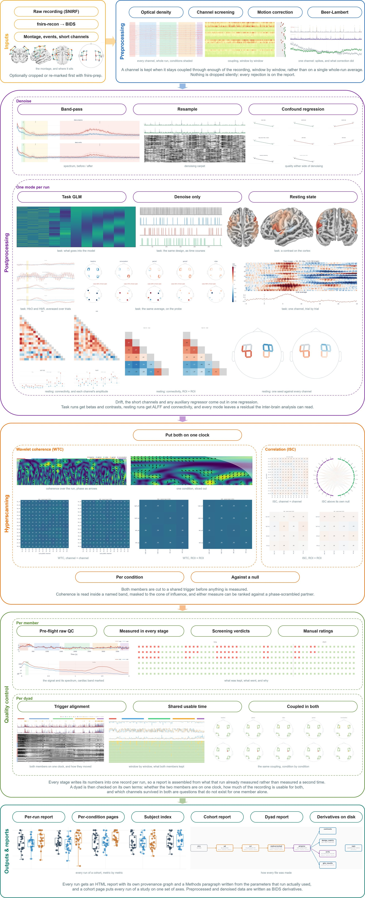

# NIRSPipe

A BIDS-compatible fNIRS preprocessing, postprocessing, hyperscanning, and QC pipeline.

> **Status: in active development.** NIRSPipe is changing quickly. Command-line options, output file names and defaults can change between releases without a deprecation period, so it is not yet recommended for production use. Pin a version for any analysis you intend to publish.

## Overview

`nirspipe` runs at two levels; dyad analysis is a separate set of commands, `nirspipe-hyper`, which reads the tree `nirspipe` wrote and writes its own.

| Level | What it does |
|-------|--------------|
| `participant` | Preprocessing in a fixed order: optical density, windowed channel screening, motion correction, Beer-Lambert. Then postprocessing when `--mode` is given: `denoise` (bandpass, resampling, optional confound regression), `glm` (first-level GLM) or `rest` (confound regression, ALFF, functional connectivity). |
| `group` | Cohort pages over the per-run quality records, and over the per-dyad ones where the tree holds dyads. |

Outputs follow the [BIDS Derivatives](https://bids-specification.readthedocs.io/en/stable/derivatives/introduction.html) specification, every file with a provenance sidecar. Each run gets an HTML QC report with a provenance graph and a generated Methods paragraph. Raw-recording, cohort and dyad QC reports, wavelet coherence and inter-subject correlation for dyads with two nulls, a rating viewer, a desktop GUI and a run-log database complete the package.



## Installation

Python 3.10 or later. Every dependency is resolved by the install:

```bash
git clone <repo>
cd NIRSPipe
pip install -e ".[dev]"
```

See [Installation](docs/installation.md) for bids-validator and the brain template the figures use.

## Quick start

Preprocessing only:

```bash
nirspipe /data/bids /data/derivatives participant \
  --participant-label 01 02 \
  --dpf 6.0 --sci-threshold 0.8 \
  --cardiac-l-freq 0.7 --cardiac-h-freq 1.5 \
  --resp-l-freq 0.1 --resp-h-freq 0.5
```

Preprocessing and a first-level GLM, with the events taken from the SNIRF annotations:

```bash
nirspipe /data/bids /data/derivatives participant \
  --participant-label 01 \
  --dpf 6.0 --sci-threshold 0.8 \
  --cardiac-l-freq 0.7 --cardiac-h-freq 1.5 \
  --resp-l-freq 0.1 --resp-h-freq 0.5 \
  --mode glm --stim-dur 15 --drift-high-pass 0.01 \
  --short-channel mean
```

The cardiac and respiration bands depend on the population and have no default. More examples are in [Usage](docs/usage.md#examples).

## Commands

| Command | Purpose |
|---------|---------|
| `nirspipe` | Preprocessing and postprocessing (`participant`), cohort QC pages (`group`) |
| `nirspipe-recon` | Convert a raw SNIRF file into BIDS |
| `nirspipe-prep` | Crop, align dyads, edit markers, write span tables |
| `nirspipe-qc` | Raw, dyad and cohort QC reports, provenance graphs |
| `nirspipe-hyper` | Dyad wavelet coherence and inter-subject correlation, with a phase-scrambled null |
| `nirspipe-hyper-pairnull`, `-groupnull`, `-band`, `-index`, `-merge` | The re-paired null, cohort tests, re-banding, the dyad index, merged tables |
| `nirspipe-rate` | Rating viewers for the QC reports |
| `nirspipe-gui` | Desktop interface |
| `nirspipe-log` | Merge the run logs into a SQLite database |

Every flag is listed in [Usage](docs/usage.md).

## Documentation

See [`docs/`](docs/).

## Development

```bash
pip install -e ".[dev]"
pytest
```

See [ROADMAP.md](ROADMAP.md) for planned features and [CHANGELOG.md](CHANGELOG.md) for release history.

## Citation

> *nirspipe is in active development. Citation instructions will be added at first stable release.*
