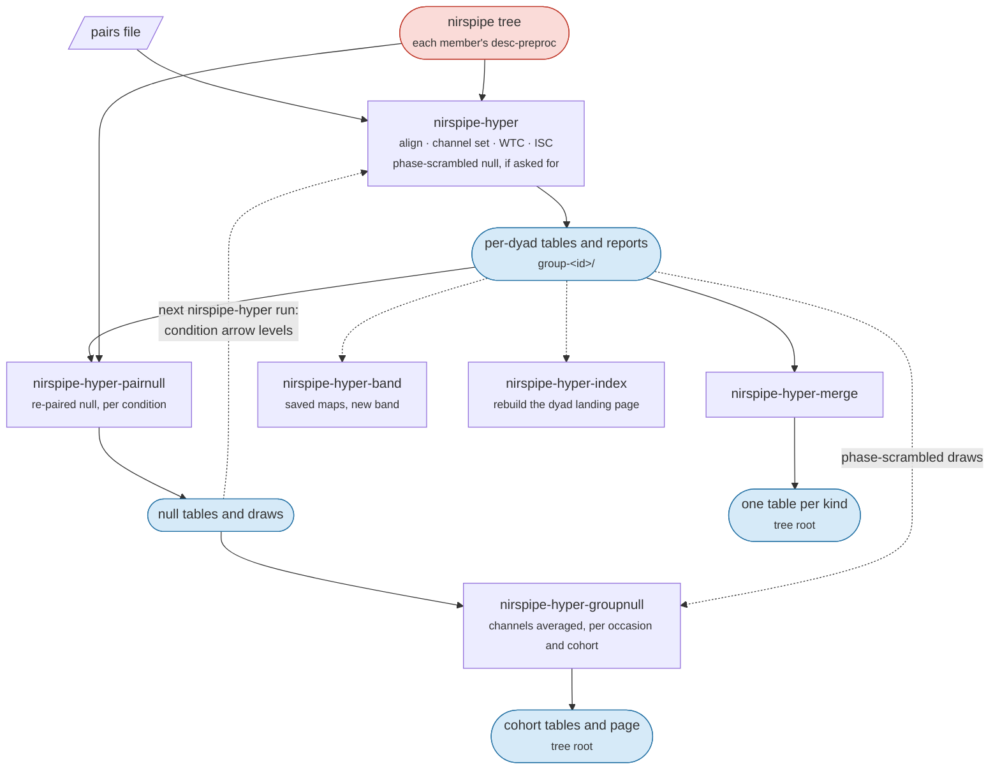

# Hyperscanning

Dyad analysis reads the tree `nirspipe` wrote and writes a tree of its own. For every pairing of members in the [pairs file](data-preparation.md#pairs-file) it computes wavelet transform coherence (WTC) and inter-subject correlation (ISC), and two nulls to compare them with. It is six commands. Their flags are in [Usage](usage.md#nirspipe-hyper), their files in [Outputs](outputs.md#the-nirspipe-hyper-tree), and the dyad reports in [QC](qc.md#dyad-reports).



A typical cohort, after `nirspipe ... participant` has run for every member:

```bash
nirspipe-hyper /data/derivatives/nirspipe /data/derivatives/nirspipe-hyper group \
    --pairs-csv pairs.csv --roi-mapping rois.json \
    --band-fmin 0.01 --band-fmax 0.10 \
    --wtc-phase-null 100 --isc-phase-null 100
nirspipe-hyper-pairnull /data/derivatives/nirspipe /data/derivatives/nirspipe-hyper group \
    --pairs-csv pairs.csv --roi-mapping rois.json
nirspipe-hyper-groupnull /data/derivatives/nirspipe-hyper group --task-label tap --roi-mapping rois.json --seed 0
nirspipe-hyper-merge /data/derivatives/nirspipe-hyper group
```

`nirspipe-hyper` and `nirspipe-hyper-pairnull` take two trees, the `nirspipe` tree and the dyad tree, which must be different folders. The other commands only read the dyad tree. `group` is the only analysis level. A group of three or more members is analysed one pairing of members at a time ([Groups of three or more](#groups-of-three-or-more)).

## Loading the members

`nirspipe-hyper` reads each member's haemoglobin data from the `nirspipe` tree: `desc-preproc` by default, or the stage `--desc` names. `--desc errts` reads the data after confound regression, so short-channel regression is applied before the coherence. A member without that stage stops its group, and the run goes on to the next group.

## Alignment

The members are put on one clock by a shared event marker: each member is cut at the first marker they all carry, and all are trimmed to the shortest. If the members share no marker, the group stops; rename the markers into one scheme first ([Editing markers](data-preparation.md#editing-markers)). Members recorded at different sampling rates are refused.

For recordings with no shared marker, such as resting state, `--no-align` trims every member to the shortest recording instead.

:::{warning}
`--no-align` assumes the members started recording at the same moment. If they did not, every pairing is compared at the wrong time. It is never used on its own when alignment fails.
:::

`--tstart` / `--tend` analyse one window of the aligned recording, where 0 is the shared marker. `--normalize` z-scores each channel for the traces the report draws; it changes no number.

## Channel set

Each member's rejected channels are taken from their `nirspipe` run, not screened again. With `--bads-scope subject` (default `run`), a channel rejected in any of a subject's runs is rejected in all of them, so every condition uses one channel set; this only matters when conditions were cropped into separate tasks before preprocessing. Members preprocessed with different short/long separation ranges are refused; the separation flags force one set.

Before the slow part starts, every dyad prints how many channels it keeps:

```
  -> G01/tapping (2 subjects)
     sub-01  long 18/20  bad 2  mean SCI 0.86  from: tapping
     sub-02  long 11/20  bad 9  mean SCI 0.41  from: tapping, rest
     [warn] sub-02 loses 9 of 20 channel pairs
```

`--check-only` prints this and stops, which is a quick way to look over a cohort before a long run.

## Wavelet transform coherence

Coherence is computed for each channel pairing over `--wtc-fmin` to `--wtc-fmax` (0.004 to 0.20 Hz by default). The number in the tables is the **band mean**: the coherence averaged over the band you choose (`--band-fmin` / `--band-fmax`) and over time, with its Fisher z.

- **Cone of influence.** By default the band mean leaves out the cone of influence, the cells near the start and end of the recording that the edges distort. `--no-wtc-mask-coi` keeps them.
- **Chromophores.** `--wtc-chroma` picks `hbo`, `hbr` and/or `hbt` (default `hbo hbr`). HbO is only ever paired with HbO, and so on. Each chromophore costs a full run.
- **Crossing.** By default every channel of one member is paired with every channel of the other, not only the same channel, and the report adds a channel-by-channel matrix. `--no-channel-cross` keeps the same-channel pairings only, and is much faster.
- **Prewhitening.** `--wtc-whiten SECONDS` removes each channel's own slow autocorrelation before the coherence. Off by default; both nulls follow it.
- **Significance contour.** `--wtc-significance` draws a significance contour against red noise on the maps. This answers a different question from the nulls below, and it is slow.

**Phase.** The tables also give the relative phase (`phase_angle`, positive where the first member leads). Do not convert a band-mean phase into a time delay: the band mixes frequencies whose phases differ. `stat-wtcphase_relmat.tsv` gives the phase per frequency with `lag_s`, and even then a delay is only trustworthy where it agrees across neighbouring frequencies. The maps draw phase arrows where the coherence is high enough ([Arrow levels](#arrow-levels)).

```{figure} figures/wtc_map.png
:alt: A wavelet coherence map of one channel pairing, time by frequency
:width: 100%

The coherence map of one channel pairing, time by frequency, under the condition windows. The washed-out band is the cone of influence, and the arrows give the relative phase where the coherence clears 0.5.
```

```{figure} figures/wtc_matrix.png
:alt: A channel-by-channel matrix of band-mean coherence between two members
:width: 70%

The channel-by-channel matrix of band means a crossed run adds to the report, one member's channels as rows and the other's as columns.
```

## Conditions and windows

By default the coherence is reported for each task condition as well as for the whole recording, and each condition gets its own report page. A marker with a duration uses it; one without runs to the next marker. A condition shorter than one cycle of `--wtc-fmin` is skipped. `--no-by-condition` turns this off.

- `--wtc-window-s SECONDS` cuts every condition into windows of that length and reports each window.
- `--wtc-cond-transform` analyses each condition separately instead of reading it out of the whole recording. It cannot be combined with `--wtc-phase-null`.

File names keep only the letters and digits of a condition's name, so two conditions that would get the same name, or a condition named `all`, are refused.

## Regions

With `--roi-mapping` ([ROI mapping file](data-preparation.md#roi-mapping-file)), region results are averages of the channel results. A region where either member keeps fewer than `--wtc-roi-min-channels` good channels (1 by default) is left blank, and `n_ch` says how many pairings each value rests on.

Two region tables are written: `agg-homologous`, each region paired with the same region, and `agg-roi`, every pair of regions.

## Inter-subject correlation

ISC is the Pearson correlation between the two members' channels, per chromophore and condition, written as a matrix and as a long table, `stat-isc_relmat.tsv`, with `r` and its Fisher z. With `--roi-mapping`, region values are written too.

With no option given, ISC is the plain correlation of the signals at zero lag. The options:

- `--isc-fmin` / `--isc-fmax` filter each member to a band first; `--band-fmin` / `--band-fmax` set this band and the coherence band together. Without them, ISC reads whatever band preprocessing left, and the run warns when it differs from the coherence band.
- `--isc-whiten-s SECONDS` removes each channel's slow autocorrelation first. Whitening makes r smaller, so do not compare whitened and unwhitened values.
- `--isc-max-lag SECONDS` keeps the strongest correlation over all shifts within that many seconds, and writes the shift as `lag_s`. The best of many shifts is larger than one shift even with no real coupling, so always pair it with `--isc-phase-null`.
- `--isc-phase-null N` compares each correlation with N phase-scrambled surrogates and adds its `percentile`.

The report's connectivity circle draws a chord where a pairing beats the 95th percentile of its surrogates or, without a null, for the strongest tenth of pairings, which is only a display cut. `--isc-threshold` sets a fixed cut instead.

```{figure} figures/isc_panel.png
:alt: An ISC matrix beside a connectivity circle of the pairings above their null
:width: 100%

The ISC matrix of one dyad beside the connectivity circle, whose chords are the pairings above the 95th percentile of their own surrogates.
```

## Nulls

Coherence between two unrelated recordings is not zero, so a value only means something compared with a null. There are two, and they answer different questions:

- the **phase-scrambled** null keeps each member's spectrum but destroys all timing, including the response both members share just because they did the same task;
- the **re-paired** null pairs a member with someone from another group who did the same task, so the shared task response is kept. A value has to beat what the task alone produces.

### Phase-scrambled null

`--wtc-phase-null N` compares each pairing with N phase-scrambled versions of its second member and writes the null mean, its spread and the `percentile` of each real value, in `null-phase_stat-wtc_relmat.tsv`. It uses the same settings as the real analysis. It is the slow part of a dyad analysis, and with crossing every iteration is much slower. `--phase-null-shared` scrambles all of a member's channels together, keeping how they correlate with each other; off by default.

### Re-paired null

`nirspipe-hyper-pairnull` replaces each pairing's second member with a member of another group who did the same task, and recomputes. It runs after `nirspipe-hyper`, reads its settings from the real tables (a different value given on the command line is refused), and works per condition only. When it finishes, it redraws those dyads' pages so their condition pages show the re-paired null; `--no-report` leaves them as they were.

- **The pool.** By default (`--wtc-pair-pool position`) a member is only replaced by someone at the same position in another group, or in the same role when the pairs file has a `role` column. Use this when one person appears in several groups. `any` draws from everyone and is refused when anyone is repeated.
- **Number of draws.** With `position`, G groups give only G - 1 draws, so a percentile can only move in steps of about 100/G. With few groups, the per-channel percentile is coarse; `nirspipe-hyper-groupnull` below is the better test.
- **Skipped candidates.** A candidate that cannot be used (unreadable, a different sampling rate, missing the condition, or a shorter block of it) is skipped, and the skips are counted by reason.
- **The correlation too.** The same draws give the ISC its re-paired null.

The two nulls are kept in separate files.

### Groups of three or more

Each pairing keeps its first-listed member and replaces the other. Within one draw, each replaced member is replaced once, by the same stand-in in every pairing they are in.

For the re-paired null, all stand-ins of one draw come from one other group, matched by position or by role. A group that no other group can fill (for example a triad among dyads matched by position) is refused before anything runs: give the pairs file a `role` column, or use `--wtc-pair-pool any`.

### Arrow levels

A phase arrow is drawn only where the coherence is above a level. The whole-run page uses the phase-scrambled null's level when there is one, else the significance contour's, else `--wtc-arrow-min` (0.5). A condition page uses the re-paired null's level when it has been computed. The page's Arrow threshold row says which level was used, and a level computed with other settings is not used (the page says why).

:::{note}
The phase columns depend on the null that was on disk when `nirspipe-hyper` ran. Rerunning a null and then `nirspipe-hyper` can change them even when the recordings did not change.
:::

## Above the channel: `nirspipe-hyper-groupnull`

With few stand-ins, no single channel can reach a small p value. `nirspipe-hyper-groupnull` averages the channels first and tests that: it cannot say which channel, but it can say whether a pairing beats its null at all. It reads the draws already written and runs no new transform.

| Level | Unit |
|-------|------|
| by cell | one channel pairing, or one region, in one condition of one occasion |
| by occasion | the channels averaged, compared with that occasion's own draws |
| cohort | the channels averaged, then the occasions averaged |

The cohort level is tested two ways, named in the `test` column: `resample` (`--n-resample`, 20000 by default) and `paired`, which tests the real values against each occasion's average null, paired over occasions. With the phase-scrambled null, read `paired` only. `--null` picks which null (`repaired`, `phase` or both), and `--chroma` which chromophores.

With `--roi-mapping`, each region is tested beside the whole-brain mean. A group of three or more counts as one occasion. When the pairs file has a `role` column, each pair of roles (`student-teacher`, `student-student`) is also tested on its own.

The coherence is tested for being above its null. For ISC, `--isc-test signed` (the default) tests in both directions; `magnitude` tests the size of the correlation regardless of sign.

:::{warning}
With `magnitude` against the phase-scrambled null and without whitening, the correlation tends to sit above the null even with no coupling. The run warns and the page says so; whiten with `--isc-whiten-s`, or keep `signed`.
:::

No correction for multiple comparisons is applied unless `--p-correction` names one (`fdr_bh`, `fdr_by`, `holm`, `bonferroni`); the uncorrected `p` is always written. Each run writes a Methods paragraph, `logs/<cohort table>_methods.md`, and the task's page, `task-<task>_desc-groupnull_report.html`.

## Excluded time

Each pairing leaves out the excluded time of both members ([Excluded time](workflows.md#excluded-time)), and both nulls do the same. Every dyad table records each pairing's kept seconds as `kept_s`.

## Running on a GPU

`--device cuda` runs `nirspipe-hyper` and `nirspipe-hyper-pairnull` on an NVIDIA card, once the optional extra is installed ([GPU](installation.md#gpu)). Each group needs about 4.5 GiB of card memory, times `--nprocs`. The command stops before starting if cupy is missing, no card is found or the memory is too small. As a check, each group's first pairing is also computed on the CPU, and a group whose two results disagree stops with nothing written.

## Other commands

**`nirspipe-hyper-band`** recomputes the band means over another band from the maps `nirspipe-hyper --wtc-save-maps` saved, without recomputing the coherence. The new band must lie inside the original frequency range.

**`nirspipe-hyper-index`** rebuilds each dyad's landing page, `group-<id>_desc-index_report.html`, from the tables. `nirspipe-hyper` already writes it; use this for a tree written earlier.

**`nirspipe-hyper-merge`** stacks every dyad's tables into one table per kind at the root of the tree, adding `group_id`, `task` and `session`, so a cohort analysis reads one file. It refuses tables computed with different settings (band, mask, whitening, stage, crossing, null), since they cannot be compared. `nirspipe-hyper` prints the merge command when the merged tables are missing or out of date.

## Resting-state dyads

Without a shared marker, pass `--no-align` to both the raw dyad QC and the analysis, so every member is trimmed to the shortest recording (see the warning under [Alignment](#alignment)):

```bash
nirspipe-qc /data/bids /data/qc participant --population adult --sci-threshold 0.8
nirspipe-qc /data/bids /data/qc group --pairs-csv pairs.csv --no-align
nirspipe-hyper /data/derivatives/nirspipe /data/derivatives/nirspipe-hyper group --pairs-csv pairs.csv --no-align
```

Single-subject resting-state connectivity and ALFF are `nirspipe --mode rest` ([Mode: rest](workflows.md#mode-rest)).
