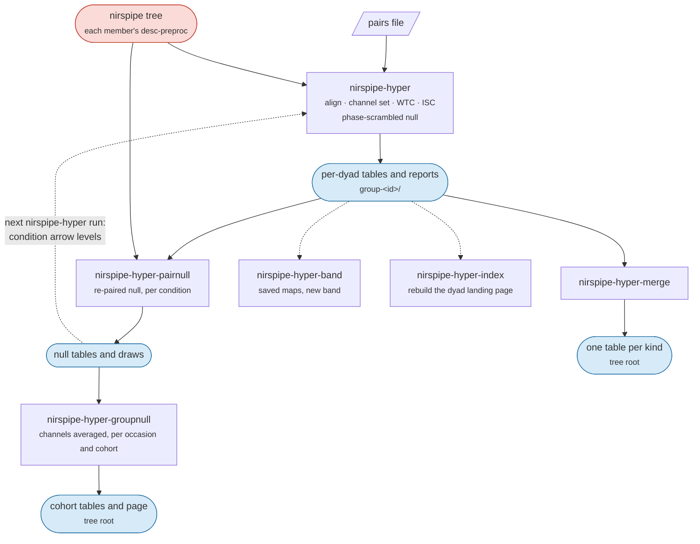

# Hyperscanning

Dyad analysis reads the tree `nirspipe` wrote and writes a tree of its own: wavelet transform coherence (WTC) and inter-subject correlation (ISC) for every member pairing in the [pairs file](data-preparation.md#pairs-file), and two nulls to read them against. It is six commands, each its own entry point. Their flags are in [Usage](usage.md#nirspipe-hyper), their files in [Outputs](outputs.md#the-nirspipe-hyper-tree), and the raw dyad QC and the dyad reports in [QC](qc.md#dyad-reports).



A typical cohort, after `nirspipe ... participant` has run for every member:

```bash
nirspipe-hyper /data/derivatives/nirspipe /data/derivatives/nirspipe-hyper group \
    --pairs-csv pairs.csv --roi-mapping rois.json \
    --band-fmin 0.01 --band-fmax 0.10 \
    --wtc-phase-null 100 --isc-phase-null 100
nirspipe-hyper-pairnull /data/derivatives/nirspipe /data/derivatives/nirspipe-hyper group \
    --pairs-csv pairs.csv --roi-mapping rois.json
nirspipe-hyper-groupnull /data/derivatives/nirspipe-hyper group --task-label tap --roi-mapping rois.json --seed 0
nirspipe-hyper-merge /data/derivatives/nirspipe-hyper group
```

`nirspipe-hyper` and `nirspipe-hyper-pairnull` read each member's recording, so they take the `nirspipe` tree and the dyad tree, which must differ: each carries its own `dataset_description.json`, and the dyad tree's links the source as `preprocessed`. The other four only re-read the dyad tree. `group` is the only analysis level, since every metric needs both members. A group of three or more members is analysed one member pairing at a time, the transform still running once over the whole group.

## Loading the members

`nirspipe-hyper` reads each member's haemoglobin stage from the `nirspipe` tree: `desc-preproc` by default, or the stage `--desc` names. `--desc errts` reads the confound-regression residual, so short-channel regression can come before the coherence; an optical-density stage is refused. A member without the stage stops that group with `MissingDerivativesError`, and the run goes on to the next group.

## Alignment

The members are put on one clock by a shared trigger: the annotation descriptions every member carries (`BAD_` ones excluded) are intersected, each member is cut at the first occurrence of a shared description, and all are trimmed to the shortest. No shared description stops that group with `AlignmentError`; rename the markers into one scheme first ([Editing markers](data-preparation.md#editing-markers)). For recordings with no shared trigger, such as resting state, `--no-align` trims every member to the shortest recording instead, which assumes the members started recording at the same moment; it is never applied on its own when alignment fails. Members recorded at different sampling rates are refused.

`--tstart` / `--tend` analyse one window of the aligned clock, where 0 is the shared trigger. The window is read out of the transform of the whole recording rather than cut from it. `--normalize` z-scores each channel per member for the traces the report draws; coherence and correlation are scale-invariant, so no number changes.

## Channel set

Each member's rejected channels are read from the record its `nirspipe` run wrote, not screened again. `--bads-scope run` (the default) applies each task's own rejections; `subject` unions them over every run of the subject the pairs file names, so every condition rests on one channel set. The two differ only where conditions were cropped into separate tasks before preprocessing.

The short and long separation bands are read from the same records. Members preprocessed with different bands are refused, naming each member's bands; the separation flags force one set for a tree written before the bands were recorded.

Before anything expensive starts, every dyad prints its channel budget:

```
  -> G01/tapping (2 subjects)
     sub-01  long 18/20  bad 2  mean SCI 0.86  from: tapping
     sub-02  long 11/20  bad 9  mean SCI 0.41  from: tapping, rest
     [warn] sub-02 loses 9 of 20 channel pairs
```

`long` is the channel count the metrics use, after the rejections; `from` names the runs the rejections came from. `--check-only` loads, aligns, prints this and stops, which is how to look over a cohort before a long run.

## Wavelet transform coherence

Coherence is computed for each channel pairing with a Morlet wavelet (`dj = 1/8`) over `--wtc-fmin` to `--wtc-fmax` (0.004 to 0.20 Hz by default). The number tables carry is the **band mean**, the coherence averaged over `--wtc-band-fmin` to `--wtc-band-fmax` (by default `--band-fmin` to `--band-fmax`, else the whole axis) and over time, with its Fisher z.

- **Cone of influence.** By default the band mean averages only the cells outside the cone of influence, the cells the edges of the record reach. `--no-wtc-mask-coi` averages the whole band. The share of band cells that held a value is written as `n_valid_frac` either way.
- **Chromophores.** HbO and HbR are two separate passes, a member's HbO paired only with the other's HbO, never mixed or averaged. `--wtc-chroma` picks `hbo`, `hbr` or `both` (the default); every band-mean table has a `chromophore` column.
- **Crossing.** By default every long channel of one member is paired with every long channel of the other, n² pairings instead of n, and the report adds the channel-by-channel matrix of band means. `--no-channel-cross` keeps the same-channel pairings only. The correlation follows the same switch.
- **Prewhitening.** `--wtc-whiten SECONDS` replaces every long channel with the residual of an autoregressive model of that many seconds of order, one order for every channel of both members, fitted on the whole aligned record. The first `order` samples are zeroed. A record shorter than four times the order is refused. Off by default; both nulls follow it.
- **Scales.** By default only the scales inside the frequency range plus a margin are computed, which gives the same coherences to the bit; `--no-wtc-limit-scales` computes them all.
- **Significance contour.** `--wtc-significance` overlays a Monte Carlo significance contour against red noise on the maps, from `--wtc-mc-count` surrogates (300) per pairing. This is a different question from the nulls below, and the runtime scales with the count.

**Phase.** The band-mean table also carries the relative phase: `phase_angle`, its circular mean in degrees, positive where the first member leads, `phase_sd` and `phase_n`. A band mean collapses scales whose phase differs, so its angle cannot be divided by a frequency to give a delay; `stat-wtcphase_relmat.tsv` resolves the phase one row per frequency, with `lag_s`. A delay is known only modulo one period, so only a `lag_s` that agrees across neighbouring scales is a delay. The maps draw phase as arrows where the coherence clears a per-frequency level ([Arrow levels](#arrow-levels)).

```{figure} figures/wtc_map.png
:alt: A wavelet coherence map of one channel pairing, time by frequency
:width: 100%

The coherence map of one channel pairing, time by frequency, under the condition windows. The washed-out band is the cone of influence, and the arrows give the relative phase where the coherence clears 0.5.
```

```{figure} figures/wtc_matrix.png
:alt: A channel-by-channel matrix of band-mean coherence between two members
:width: 70%

The channel-by-channel matrix of band means a crossed run adds to the report, one member's channels as rows and the other's as columns.
```

## Conditions and windows

By default the coherence is read out of each task annotation's window as well as over the whole recording. A trigger with a duration uses it; one without runs to the next trigger, and the last to the end of the recording. Each window is read out of the transform of the whole recording rather than transformed on its own, so it costs no second transform and is not inflated by edges of its own. A window shorter than one cycle of `--wtc-fmin` is skipped. The windows land in the same tables as the whole recording, after its rows, told apart by a `condition` column that is `n/a` on the whole recording's rows, as the correlation's table does; each window gets a report page. `--no-by-condition` turns this off.

- `--wtc-window-s SECONDS` cuts every condition into non-overlapping windows of that length and makes the window the unit; the remainder past the last whole window is dropped.
- `--wtc-cond-transform` transforms each condition on its own instead, keeping `--wtc-cond-pad-s` seconds either side and windowing them back off. With the default `auto` margin, `2*sqrt(2)/--wtc-band-fmin`, the numbers match the default route. It is refused with `--wtc-phase-null`.

A file name keeps only a condition's letters and digits, so two conditions that would share one name, or a condition named `all`, are refused.

## Regions

With `--roi-mapping` ([ROI mapping file](data-preparation.md#roi-mapping-file)), region results are averaged out of the channel results rather than transformed again: the maps of a region's channel pairings are averaged into a region map, and the band means into a region mean. The two orders give the same number. Phase is averaged as a direction, the pairings summed as unit vectors. A region cell where either member contributes fewer than `--wtc-roi-min-channels` channels (1 by default) is left blank and keeps its row, its `n_ch` column saying how many pairings the value rests on.

Two region tables are written: `agg-homologous`, each region's same-channel pairings averaged, and `agg-roi`, the region-by-region matrix, which under crossing holds every ordered pair of regions.

## Inter-subject correlation

ISC is the Pearson correlation between the long channels of the two members, written as a matrix per chromophore and window (sub1's channels as rows, sub2's as columns, the montage's channels throughout, a rejected one blank) and as one long table, `stat-isc_relmat.tsv`, one row per pairing with `r` and its Fisher z `r_z`. For a condition window the correlation is computed on that window alone. With `--roi-mapping`, region cells average the channel correlations in Fisher z, written as a matrix per chromophore and window and as one long table, `seg-<map>_agg-roi_stat-isc_relmat.tsv`.

All of its options are off by default, so a run naming none reports the zero-lag correlation of the signals themselves.

- `--isc-fmin` / `--isc-fmax` band-limit each member before the correlation, and before a window is cut. Without them, or `--band-fmin` / `--band-fmax`, which set the coherence band and this one together, the correlation reads whatever band preprocessing left. The run warns when the two bands differ.
- `--isc-whiten-s SECONDS` correlates the residuals of an autoregressive model, by the coherence's rule with an order of its own. Whitening shrinks r, so a whitened matrix does not compare with an unwhitened one.
- `--isc-max-lag SECONDS` keeps the strongest correlation over every shift within that many seconds either way, sign kept, and writes the shift as `lag_s`, positive where the second member follows. The maximum over many shifts is larger than any single one under no coupling, so pair it with `--isc-phase-null`.
- `--isc-phase-null N` ranks each correlation against N phase-scrambled surrogates of the second member, searched the same way, adding `null_abs_mean`, `null_abs_sd`, `null_abs_p95` and `percentile` and keeping every draw.

The report's connectivity circle draws a chord where a pairing beats the 95th percentile of its own surrogates, or, without a null, for the strongest tenth of pairings, labelled as a display cut. `--isc-threshold` forces an absolute cut instead.

```{figure} figures/isc_panel.png
:alt: An ISC matrix beside a connectivity circle of the pairings above their null
:width: 100%

The ISC matrix of one dyad beside the connectivity circle, whose chords are the pairings above the 95th percentile of their own surrogates.
```

## Nulls

Coherence between two unrelated recordings is not zero, so a value is read against a null. Two are available, and they control for different things: the phase-scrambled partner keeps each member's spectrum but destroys every temporal relation, including the response both members share because they did the same task; the re-paired partner keeps that task-locked structure, so a value has to exceed the coupling the shared task alone produces.

### Phase-scrambled null

`--wtc-phase-null N` recomputes the band means against N phase-randomised surrogates of one member and writes their mean in `null-phase_stat-wtc_relmat.tsv`, with `null_sd`, `null_p95`, `n_iter` and the `percentile` each real value sits at among the draws. It shares the run's stage, band, mask, whitening, channel set and windows; with conditions on, it follows the same windows at no extra transform and keeps every iteration in a `desc-draws` table. Crossing it squares the cost of every iteration, so it follows `--channel-cross` unless `--wtc-phase-null-cross` / `--no-wtc-phase-null-cross` says otherwise. Each iteration is a full coherence run, which makes this the expensive half of a dyad analysis.

### Re-paired null

`nirspipe-hyper-pairnull` replaces one member with a member of another group who did the same task, and recomputes. It reads the real tables first, so it runs after `nirspipe-hyper`, and only per condition window: each condition is cut from each side's own marker for it, so every draw is as long as the condition it stands in for. There is no whole-run re-paired null.

- **Settings come from the real tables.** The band, mask, frequency range, windows, whitening and alignment are read off the real tables' sidecars, and so are `--desc`, `--bads-scope` and `--wtc-roi-min-channels`; a value given that differs is refused. The crossing follows the real table unless `--wtc-pair-cross` / `--no-wtc-pair-cross` is given.
- **The pool.** `--wtc-pair-pool position` (the default) replaces a member only with another group's member at the same position in the pairs file, the only safe pool when one person appears in several groups. `any` draws from every other group's members and is refused when anybody is repeated. With `position` there is one candidate per other group, so G groups give G - 1 draws, and a `percentile` resolves to about 100/G points. `--wtc-pair-max` stops after N draws.
- **Skipped candidates.** A candidate whose recording cannot be read, was recorded at another rate, has no quality record, lacks a condition's marker, has a shorter block of that condition, or is too short to whiten, is skipped, and the refusals are counted by reason (`pair_refused`).
- **The correlation too.** The same draws give the correlation's re-paired null, whose `percentile` ranks \|r\| among the \|draws\|.

The two nulls are written to separate files, and `nirspipe-hyper-merge` refuses to combine them.

### Arrow levels

A phase arrow is drawn only where the coherence clears a per-frequency level. The whole-run page uses the phase-scrambled level, else the Monte Carlo one, else the flat `--wtc-arrow-min` (0.5). A condition page uses the re-paired level `nirspipe-hyper-pairnull` wrote, else what the whole-run page used; its ISC chords likewise use the re-paired correlation null. The re-paired level reaches the pages on the next run: `nirspipe-hyper`, then `nirspipe-hyper-pairnull`, then `nirspipe-hyper` again. A level is used only when its sidecar matches the run (frequency range, mask, whitening, wavelet grid, alignment, sources, and each condition's span); otherwise the page says which file it did not use and why. The page's Arrow threshold row names the level used, and every band-mean table records it as `phase_level_source`.

## Above the channel: `nirspipe-hyper-groupnull`

Ranking each channel inside its own draws spends the pool's resolution on every cell: against k stand-ins no cell can reach a *p* under 1/(k+1). `nirspipe-hyper-groupnull` averages the channels first and ranks that. It cannot say which channel, but it can say whether the pairing beats its null at all. It reads the draws already written, for the coherence and the correlation alike, and runs no transform.

| Level | Unit |
|-------|------|
| by cell | one channel pairing, or one region, in one condition of one occasion |
| by occasion | the channels averaged, ranked in that occasion's own draws |
| cohort | the channels averaged, then the occasions averaged |

The cohort level is written two ways, a `test` column naming each. `resample` redraws one stand-in per occasion (`--n-resample`, 20000) and ranks the real statistic inside that; `paired` averages each occasion's draws into one baseline and tests the real values against it, paired over occasions. On the phase-scrambled null `paired` is the only valid read. `--null` names which draws are read (`repaired`, `phase` or both; by default every null whose draws are on disk), `--chroma` which chromophores (`hbo` by default); each combination writes its own tables.

With `--roi-mapping` each region is a level beside the whole-brain mean, its homologous pairings averaged, and when the null was drawn crossed every ordered region pair is a level too. A region is ranked for an occasion only where that dyad's own table kept it.

The coherence is always tested above its null. The correlation is averaged in Fisher z and `--isc-test` sets the read: `signed` (the default) averages z and tests two-sided, `magnitude` averages \|z\| and tests above the null.

No multiple-comparison correction runs unless `--p-correction` names one (`fdr_bh`, `fdr_by`, `holm`, `bonferroni`); the uncorrected `p` is always written, and a method adds a `p_<method>` column. Every table writes `family`, the number of tests a correction runs over. Each run also writes a Methods paragraph for the test, `logs/<cohort table>_methods.md`, and rewrites the task's page, `task-<task>_desc-groupnull_report.html`, from every cohort table on disk.

## Excluded time

The transform and the prewhitening run on each member's whole record. A pairing then leaves out the union of the two members' `BAD_` spans ([Excluded time](workflows.md#excluded-time)): the excluded columns leave the band means, the phase averages and `n_valid_frac`, and the correlation reads only the samples both members kept. Prewhitening fits each member's coefficients on that member's own kept time. A coherence cell where either member has no power left, as deep inside a long filled span, is NaN. Both nulls leave out the real pairing's excluded time; the re-paired null also leaves out each stand-in's own corrupted spans. Every dyad table records each pairing's `kept_s`.

## Other commands

**`nirspipe-hyper-band`** re-averages the maps `nirspipe-hyper --wtc-save-maps` saved over another band, with no second transform, and writes tables only, named with a `band-` entity beside the originals. The band must lie inside the frequency axis the maps were computed on.

**`nirspipe-hyper-index`** rebuilds each dyad's landing page, `group-<id>_desc-index_report.html`, from the tables alone. `nirspipe-hyper` writes it as its last step; this is for a tree produced earlier.

**`nirspipe-hyper-merge`** concatenates every per-dyad long table into one table per kind at the root of the tree, adding `group_id` and `task` (and `session` where any input has one), so a cohort analysis reads one file. The correlation matrices stay in each dyad's folder: the long tables carry the same values one row per pairing, which is the shape that stacks across dyads. It refuses tables that disagree on the band, the mask, the whitening, the stage, the rejection scope, the region minimum or which null they are, and crossed tables beside homologous ones. A differing number of null iterations only warns, since `n_iter` is kept per row. `nirspipe-hyper` prints the merge command when the merged tables are missing or older than the per-dyad ones.

## Resting-state dyads

Without a shared trigger, pass `--no-align` to both the raw dyad QC and the analysis, so every member is trimmed to the shortest recording:

```bash
nirspipe-qc hyper-raw /data/bids /data/derivatives/nirspipe-hyper group --pairs-csv pairs.csv --no-align \
    --dpf 6.0 --cardiac-l-freq 0.7 --cardiac-h-freq 1.5 --sci-threshold 0.8
nirspipe-hyper /data/derivatives/nirspipe /data/derivatives/nirspipe-hyper group --pairs-csv pairs.csv --no-align
```

Single-subject resting-state connectivity and ALFF are `nirspipe --mode rest` ([Mode: rest](workflows.md#mode-rest)).
