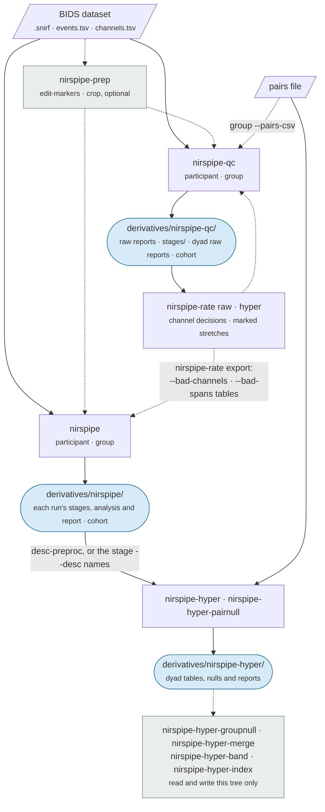

# Outputs

`nirspipe` writes a BIDS derivatives tree, `nirspipe-qc` a raw QC tree, and the dyad commands a third, each in a folder of its own. The figure shows what each command reads and where it writes. This page lists what each tree holds, how the files are named, and the logs and run records every run leaves.



`nirspipe` and `nirspipe-qc` read the same input and never each other's tree, so each prepares the recordings on its own. The dyad commands read only the `nirspipe` tree.

## Naming

Every name is built from BIDS entities. `<run>` below stands for the input recording's own, `sub-<label>[_ses-<label>]_task-<label>[_acq-<label>][_run-<index>]`, and `<task>` for the same without the run.

| Entity | Means |
|--------|-------|
| `desc-` | The processing stage, or which record a QC file is |
| `stat-` | The measure in a table, such as `alff`, `pearson`, `fisherz`, `wtc`, `isc`, or the quality record's `sci`, `psp`, `cv` |
| `chromo-` | The chromophore, where a file holds one: `hbo`, `hbr`, or `hbt` when `--chromophores` or `--wtc-chroma` asks for it |
| `seg-`, `agg-` | The ROI mapping a table was grouped by (the file's stem reduced to letters and digits) and how channels were aggregated: `roi`, `seed`, `homologous` |
| `cond-` | A condition window |
| `group-`, `pair-` | A dyad, and a member pairing inside a group of three or more |
| `null-` | Which null a table holds: `phase` or `pair` |
| `band-` | A re-averaged band from `nirspipe-hyper-band` |
| `chan-`, `label-` | A channel or a region, in figure names |
| `space-` | The head template a table's channel positions are on: `fsaverage`, or an infant template |
| `rater-` | Who saved a rating file, with `nirspipe-rate --rater` |

The suffix says what a file holds: `nirs` a signal, `relmat` a relation between channels or regions, `nirsmap` one value per channel or region, `qc` quality numbers, `report` a page. A run's outputs keep its input's `ses`, `task`, `acq` and `run`. Some of these entities and suffixes (`group-`, `chromo-`, `relmat`, `nirsmap` and others) are not yet part of BIDS, so a BIDS validator may flag them.

## The `nirspipe` tree

```
derivatives/nirspipe/
├── dataset_description.json             ← links the input as raw under DatasetLinks and SourceDatasets
├── .bidsignore
├── plotly-<version>.min.js             ← the reports' Plotly.js when the CDN does not load
├── desc-subjects_qc.tsv                 ← cohort table (nirspipe group)
├── desc-subjects_qc.json                ← what each of its columns holds
├── desc-conditions_qc.tsv               ← the same per run and condition, with its .json
├── desc-subjects_report.html            ← cohort page
├── desc-subjects_nirsmap.tsv            ← every run's per-channel values, one long table
├── desc-fcmovement_qc.tsv               ← per task, each connection's r between movement and FC across runs
├── desc-ratedchannels_qc.tsv            ← nirspipe-rate export: the --bad-channels table
├── desc-ratedspans_qc.tsv               ← nirspipe-rate export: the --bad-spans table
├── desc-ratedpages_qc.tsv               ← nirspipe-rate export: every FINAL verdict, for reading
├── figures/                             ← the cohort page's figures
├── logs/                                ← the rating viewers' saved verdicts
└── sub-<label>/
    ├── sub-<label>_desc-index_report.html          ← index over the subject's runs
    ├── <run>_report.html                           ← run report
    ├── <run>_cond-<condition>_report.html          ← + --by-condition
    ├── <run>_desc-mne_report.html                  ← MNE's own report of the run
    ├── figures/                                    ← every figure of every run, one flat folder
    ├── logs/
    │   ├── sub-<label>[_ses-<s>][_task-<t>].log    ← text log, named by the run's selection
    │   └── sub-<label>[_ses-<s>][_task-<t>].toml   ← run record
    └── [ses-<label>/]nirs/                         ← every data file has a .json sidecar
        ├── <run>_desc-od_nirs.snirf                ← prep: optical density
        ├── <run>_desc-sci_nirs.snirf               ← prep: channel screening
        ├── <run>_desc-motcorrected_nirs.snirf      ← prep: motion correction
        ├── <run>_desc-preproc_nirs.snirf           ← prep: Beer-Lambert, end of preprocessing
        ├── <run>_desc-aux_timeseries.tsv.gz        ← aux channels, when the recording has any
        ├── <run>_space-<template>_channels.tsv     ← channel positions on the run's head template, in mm, and their cortical regions
        ├── <run>_desc-filtered_nirs.snirf          ← post: bandpass
        ├── <run>_desc-resampled_nirs.snirf         ← post: + --resample-sfreq
        ├── <run>_desc-errts_nirs.snirf             ← post: regression residual
        ├── <run>_desc-errtsbroad_nirs.snirf        ← rest: broadband residual, the ALFF input
        ├── <run>_desc-meanfilled_nirs.snirf        ← + --export-mean-filled
        ├── <run>_desc-sqm_qc.json                  ← quality record, its scalars
        ├── <run>_stat-{sci,psp,cv}_desc-sqm_timeseries.tsv   ← its channel × window matrices
        ├── <run>_stat-summary_desc-sqm_timeseries.tsv        ← its per-window series
        ├── <run>_desc-sqm_nirsmap.tsv              ← its per-channel values
        ├── <run>_desc-channel_qc.tsv               ← per-channel metrics and verdicts
        ├── <run>_design.tsv                        ← design matrix, whenever a regression ran
        ├── <run>_desc-glm_nirsmap.tsv              ← fit results, one row per channel and regressor
        ├── <run>_desc-contrast_nirsmap.tsv         ← glm + --contrast-file
        ├── <run>_desc-blockavg_timeseries.tsv      ← glm: each condition's trial average per channel
        ├── <run>_desc-whitening_nirsmap.tsv, <run>_stat-psd_desc-whitening_timeseries.tsv  ← glm: how well the noise model whitened each channel
        ├── <run>_stat-alff_nirsmap.tsv             ← rest: alff, falff, malff, zalff per channel
        ├── <run>_seg-<map>_agg-roi_stat-alff_nirsmap.tsv                ← + --roi-mapping
        ├── <run>_chromo-<c>_stat-{pearson,fisherz}_relmat.tsv           ← rest or --fc, one per chromophore
        ├── <run>_chromo-<c>_stat-pearson_desc-<stage>_relmat.tsv        ← the same before the regression, on the stage it started from
        ├── <run>_chromo-<c>_seg-<map>_agg-{roi,seed}_stat-{pearson,fisherz}_relmat.tsv  ← + --roi-mapping
        ├── <task>_desc-<stage>_nirs.snirf          ← --combine-runs: the task's runs joined, named without run-
        ├── <task>_chromo-<c>_..._relmat.tsv        ← --combine-runs: FC of the joined series, as above
        ├── <page>_desc-rating_qc.json, <page>_desc-rawrating_qc.json    ← section ratings
        ├── sub-<label>[_ses-<label>]_task-<label>_desc-rawdecision_qc.json  ← channel decisions
        └── sub-<label>[_ses-<label>]_task-<label>_desc-rawspans_qc.json     ← stretches marked bad
```

With `nirspipe-rate --rater`, the rating files carry the rater before `desc-` (`..._rater-QY_desc-rawdecision_qc.json`), and the exported tables a `rater` column ([Rating](qc.md#rating)).

A step that did not run writes nothing: `desc-filtered` is absent when both cutoffs are off, `desc-resampled` without `--resample-sfreq`, and the quality record has no section for a stage that does not exist.

**Tables.** Every table is tab-separated and writes a missing value as `n/a`, as BIDS requires. pandas reads `n/a` as missing by default; in R, pass `na = c("", "NA", "n/a")` to `read.delim` or `readr::read_tsv`, or the column is read as text. A connectivity matrix keeps every long channel of the montage, a rejected channel as a blank row and column, so every subject's matrices have the same shape; short channels are left out, as in the dyad tables. Its diagonal is 1, and blank in the Fisher z matrix, where it would be infinite. Each table's sidecar describes its columns and, where a column has one, its unit (haemoglobin is in M, mol/L). In the GLM and contrast tables, `df` is each channel's own residual degrees of freedom and `p_value` is two-sided on it. The quality record is described in [QC](qc.md#the-quality-record).

## The raw QC tree

`nirspipe-qc` writes one tree for both levels: each subject under `sub-<label>/`, each dyad under `group-<id>/`, and the cohort pages at the root. Give it a folder of its own, apart from the `nirspipe` tree, as in the examples. Pointing both commands at one folder works but is not recommended, and each command says so once when it finds the other's records there.

```
derivatives/nirspipe-qc/
├── dataset_description.json
├── .bidsignore
├── plotly-<version>.min.js
├── desc-subjects_qc.tsv, desc-subjects_report.html    ← group level: the cohort of runs
├── desc-conditions_qc.tsv                             ← group level: the same per run and condition
├── desc-subjects_nirsmap.tsv                          ← group level: every run's per-channel values
├── desc-groups_qc.tsv, desc-groups_report.html        ← group level + --pairs-csv: the cohort of dyads
├── desc-groupconditions_qc.tsv                        ← group level + --pairs-csv: the same per dyad and condition
├── figures/                                           ← the cohort pages' figures
├── stages/                                            ← participant level: each recording as prepared, a dataset of its own
│   └── sub-<label>/[ses-<label>/]nirs/                ← desc-od, desc-sci, desc-motcorrected, desc-preproc, as in the nirspipe tree
├── sub-<label>/
│   ├── sub-<label>_desc-index_report.html
│   ├── <run>_desc-raw_report.html                     ← participant level
│   ├── <run>_cond-<condition>_desc-raw_report.html    ← + --by-condition
│   ├── figures/
│   ├── logs/<stem>_desc-raw.toml                      ← its run record, which --config reruns
│   └── [ses-<label>/]nirs/
│       ├── <run>_desc-sqmraw_qc.json                  ← the raw quality record and the settings it prepared with
│       └── <run>_desc-rawchannel_qc.tsv               ← per-channel metrics and verdicts
└── group-<id>/
    ├── group-<id>_task-<t>_desc-raw_report.html      ← group level + --pairs-csv
    ├── figures/
    ├── logs/group-<id>_task-<t>_desc-raw.log         ← its live log
    └── [ses-<s>/]nirs/                               ← every table has a .json sidecar
```

`stages/` holds each recording as the participant level prepared it, with the same steps and file names as the `nirspipe` tree's preprocessing files. The dyad reports read their members from there, so keep it with the tree.

Per group and task the group level writes:

| File | Holds |
|------|-------|
| `desc-sqm_qc.json` | The dyad's quality record, which the cohort of dyads reads |
| `desc-subject_qc.tsv` | One row per member: every scalar of its raw quality view |
| `desc-channel_qc.tsv` | One row per member and channel: `sci_win`, `sci_whole`, `is_bad` |
| `desc-usable_qc.tsv` | One row per channel pair and condition (`whole_run` for a dyad with no conditions): `usable_frac`, `one_member_frac`, `neither_frac`, `n_windows` |

## The `nirspipe-hyper` tree

The dyad commands write a tree separate from the one `nirspipe` wrote. A group the pairs file records per session puts `ses-<s>` after `group-<id>` in every name and its tables in `group-<id>/ses-<s>/nirs/`.

```
derivatives/nirspipe-hyper/
├── dataset_description.json
├── .bidsignore
├── plotly-<version>.min.js
├── stat-wtc_relmat.tsv, stat-isc_relmat.tsv, ...  ← nirspipe-hyper-merge, one per long-table kind
├── chromo-<c>_task-<t>_cond-all_null-<n>_stat-<s>_desc-{bycell,byoccasion,cohort}_relmat.tsv  ← nirspipe-hyper-groupnull
├── task-<t>_desc-groupnull_report.html            ← nirspipe-hyper-groupnull
├── figures/                                       ← that page's figures
├── logs/                                          ← the cohort tests' Methods paragraphs
└── group-<id>/
    ├── group-<id>_desc-index_report.html          ← one row per analysed window
    ├── group-<id>_task-<t>_report.html            ← dyad analysis report
    ├── group-<id>_task-<t>_cond-<c>_report.html   ← one per condition window
    ├── figures/
    ├── logs/group-<id>_task-<t>.{log,toml}        ← nirspipe-hyper's live log and run record
    ├── logs/group-<id>_task-<t>_null-pair.log     ← nirspipe-hyper-pairnull's live log
    ├── logs/group-<id>_task-<t>_redraw.log        ← its redraw of the dyad's pages
    └── nirs/                                      ← every table has a .json sidecar
```

`nirspipe-hyper` writes, per group and task (the names below drop the leading `group-<id>_task-<t>_`):

| File | Holds |
|------|-------|
| `stat-wtc_relmat.tsv` | Band-mean coherence, one row per channel pairing, chromophore and window: `chromophore`, `condition` (`whole_run` for the whole recording; a table with no conditions has no `condition` column), `sub1`, `sub2`, `label` (and `label2` when crossed), `coherence`, `coherence_z`, `n_valid_frac`, `phase_angle`, `phase_sd`, `phase_n`, `kept_s` |
| `seg-<map>_agg-roi_stat-wtc_relmat.tsv`, `seg-<map>_agg-homologous_stat-wtc_relmat.tsv` | The region tables, laid out the same way |
| `stat-wtcphase_relmat.tsv` | Relative phase per frequency, with `lag_s`, laid out the same way |
| `null-phase_stat-wtc_relmat.tsv` and its region twins | The phase-scrambled null (with `--wtc-phase-null`), one row per pairing as in the real table: `null_mean` and `null_mean_z` (the null's centre, where the real table has `coherence`), `null_sd`, `null_p95`, `percentile`, `n_iter`, `n_valid_frac` |
| `cond-all_null-phase_stat-wtc_desc-draws_relmat.tsv` | Every iteration of that null, one row per pairing it measured: a pairing a rejected channel left blank has no row |
| `chromo-<c>_null-phase_stat-wtc_desc-level_relmat.npz` and its region twin | That null's coherence level per frequency, which the maps draw phase arrows against |
| `chromo-<c>_stat-wtc_relmat.npz` | The full time-frequency maps (with `--wtc-save-maps`) |
| `stat-isc_relmat.tsv` | The correlations, one row per pairing and window: `chromophore`, `condition`, `sub1`, `sub2`, `label`, `label2`, `r`, `r_z`, `kept_s`, and `lag_s` and the null columns where asked for |
| `seg-<map>_agg-roi_stat-isc_relmat.tsv` | The region correlations, laid out as `stat-isc_relmat.tsv` |
| `chromo-<c>[_cond-<c>]_stat-isc_relmat.tsv`, `..._seg-<map>_agg-roi_...` | The correlation matrices, per chromophore and window |
| `cond-all_null-phase_stat-isc_desc-draws_relmat.tsv` | Every surrogate of the correlation (with `--isc-phase-null`), one row per pairing it measured |
| `desc-bad_qc.tsv` | Each member's excluded channels and the runs that rejected them |
| `space-<template>_channels.tsv` | Each member's channel positions and cortical regions |

`nirspipe-hyper-pairnull` writes its tables beside them, named with `null-pair` (`cond-all_null-pair_stat-wtc_relmat.tsv`, `cond-all_null-pair_stat-isc_relmat.tsv` and their draws, whose correlation column is `r` as in the real table), and `chromo-<c>_cond-all_null-pair_stat-wtc_desc-level_relmat.npz`, the level the next `nirspipe-hyper` run draws each condition's phase arrows against. `nirspipe-hyper-band` writes `..._chromo-<c>_band-<band>_stat-wtc_relmat.tsv` beside each saved map. Each table's sidecar records the settings it was computed with.

## Sidecars and provenance

Every data file has a JSON sidecar beside it, recording the step that made it, the settings it used and the files it was made from, and for a signal or an analysis table its bad channels and excluded time. You rarely need to read one: the report's provenance graph and Methods paragraph are built from them.

:::{note}
The processing stage is part of the file name (`desc-`). Do not rename files by hand: the sidecars of later files point at the original names, and the reports and dyad commands will not find them.
:::

The sidecars find their sources through relative links to the raw dataset and, for a dyad tree, to the `nirspipe` tree. When you move or share the trees, keep them in the same places relative to each other.

**The provenance graph.** Each run gets a graph of how its files were made, `figures/<run>_desc-provenance_nirs.png`, which the run report shows. Each input names the dataset it was read from (raw data, or preprocessed data for a dyad). A file that has gone missing is drawn with a dashed red outline. `nirspipe-provenance OUTPUT_DIR` redraws the graphs for any past run.

```{figure} figures/provenance.png
:alt: A provenance graph of one run, one box per file
:width: 100%

The provenance graph of a GLM run: one box per file, labelled with the step that made it and, for the signal files, the channels kept, the sampling rate and the duration.
```

## Logs and run records

| Layer | Format | Path | For |
|-------|--------|------|-----|
| Live log | Text | `sub-<label>/logs/sub-<label>[_ses-<s>][_task-<t>].log` | Following a run; `--verbose` adds debug output |
| Dyad live log | Text | `group-<id>/logs/group-<id>_task-<t>.log`, `_desc-raw.log` for the raw QC group level, `_null-pair.log` for the re-paired null, `_redraw.log` for the pages it redraws | Following one group of a dyad command |
| Run record | TOML | `sub-<label>/logs/sub-<label>[_ses-<s>][_task-<t>].toml` | What a subject was run with, and rerunning it |
| Provenance | JSON sidecars and a graph | `nirs/*.json`, `figures/*_desc-provenance_nirs.png` | How one file was made |

The log and the run record are named after what the run selected, for example `sub-01_ses-1+2` for `--session-label 1 2`, and `sub-01_acq-hi_run-1` for a `--bids-filter-file` holding `{"acquisition": "hi", "run": 1}`, whose content the record also stores. Rerunning the same selection replaces them.

### Run record

Each subject's run record holds the software versions, the exact command, every setting the run used, and, for each postprocessing setting, where it came from: the command line (`cli`), `--config`, the `mode` or the `default`. When the run ends, an `[outcome]` section says whether it succeeded and, if not, the first line of the error; the full error is in the log. A record without `[outcome]` belongs to a run that was stopped. The cohort page lists every subject whose last run did not succeed.

```toml
[execution]
run_command = "nirspipe /data/bids /data/out participant --dpf 6 --sci-threshold 0.8 --mode glm ..."
participant_label = [ "01" ]
task_label = [ "tapping" ]

[prep]
dpf = [ 6.0 ]
sci_threshold = 0.8
motion_correction = "tddr"
window_length = 10.0

[post]
mode = "glm"
hrf_model = "spm"
noise_model = "auto"
drift_model = "cosine"
drift_high_pass = 0.01

[post_sources]
mode = "cli"
hrf_model = "mode"
noise_model = "mode"
drift_model = "mode"
drift_high_pass = "cli"
```

A run record is a config file: `--config` on it reruns the run it records ([Configuration file](usage.md#configuration-file)).
