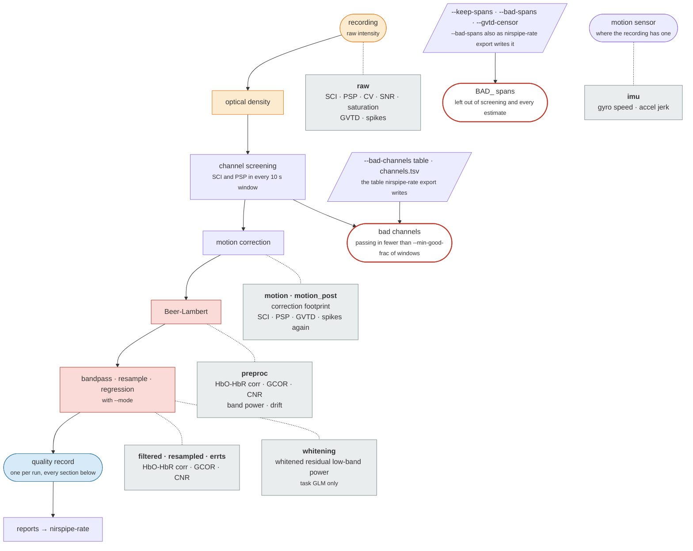

# Quality control

Every run gets a quality record (its quality metrics) and an HTML report built from it. Separate commands report on raw recordings before any processing, on a whole cohort, and on dyads. A rating viewer turns any report into a form for recording your own verdicts.

| Report | Command | File |
|--------|---------|------|
| Run report | `nirspipe ... participant`, automatically | `sub-<label>/<run>_report.html` |
| Condition pages | `--by-condition` on `nirspipe` or `nirspipe-qc ... participant` | `<run>_cond-<condition>_report.html`, `..._desc-raw_report.html` |
| Subject index | `nirspipe` or `nirspipe-qc ... participant` | `sub-<label>/sub-<label>_desc-index_report.html` |
| Raw report | `nirspipe-qc ... participant` | `sub-<label>/<run>_desc-raw_report.html` |
| Cohort of runs | `nirspipe-qc ... group` or `nirspipe ... group` | `desc-subjects_report.html` at the tree root |
| Dyad raw report | `nirspipe-qc ... group --pairs-csv` | `group-<id>/<group run>_desc-raw_report.html` |
| Dyad analysis report | `nirspipe-hyper` | `group-<id>/<group run>_report.html`, one page per condition, and the dyad index |
| Cohort of dyads | `nirspipe-qc ... group --pairs-csv` or `nirspipe ... group` | `desc-groups_report.html` at the tree root |

The metrics work on any recording, whatever its design. The one exception is CNR, which needs event annotations; a run without them has no CNR.

## The quality record

`nirspipe` writes one record per run, `<run>_desc-sqm_qc.json`, once preprocessing and postprocessing have both finished. `nirspipe-qc ... participant` writes the raw part of the same record to `<run>_desc-sqmraw_qc.json`, and `nirspipe-qc ... group --pairs-csv` writes a dyad record under `group-<id>/nirs/`. The cohort pages are built from these records.

The record is split into sections named after the stage they were measured on (`raw`, `motion`, `preproc`, `errts` and so on), and each is measured on all channels, the long channels and the short channels separately: `raw` is every channel, `raw_long` and `raw_short` the two sets. The per-window series and the flagged stretches (GVTD above its threshold, spikes, corrected samples) are named the same way: `gvtd_filt_per_window` is every channel, `gvtd_filt_per_window_long` and `_short` the sets. Measures taken on the raw signal include rejected channels; measures taken on haemoglobin leave them out. `<run>_desc-channel_qc.tsv` beside the record holds one row per channel, with its metrics and its verdict, and the `.json` beside it says what each column holds. An older record, which named the long set's series plainly and every channel's `_all`, is refused rather than read the wrong way round; rerun the command that wrote it.

## Metrics

Every metric the record keeps is listed below with the label the report prints and the text it shows when you hover that label. Each entry ends with how to read the value: higher is better, lower is better, best near a given value, or descriptive. The report colours five of them, and none of them rejects anything: channels are rejected one at a time, by the screening ([Quality Metrics](#quality-metrics)).



In the diagram, grey boxes are measured and drawn but change nothing; the two red ones act on the data: bad channels and excluded time.

### Coupling and signal level

How well the optodes touched the scalp, and how strong and steady the light was. For coupling, read the windowed SCI: it is what screening counts, and the whole-run SCI can disagree with it.

SNR is labelled μ/σ, the mean intensity over its standard deviation, so its line of 20 is the same as a CV of 5%. Some papers give SNR in decibels instead; 20 is about 26 dB.

Two checks read the pulse itself. The heart rate should lie inside the cardiac band that SCI and PSP look in; when it does not, the report says so, and the band (`--cardiac-l-freq`, `--cardiac-h-freq` or `--population`) is probably wrong for your participants. The cardiac HbO/HbR ratio checks the two wavelength labels: the pulse is arterial, so it should show up mostly in HbO. When most runs of a task read the other way round, the cohort page warns that the labels may be swapped.

```{eval-rst}
.. metric-reference:: coupling
```

### Motion from the optical signal

Motion measured from the optical signal itself. The band-passed GVTD is the trace the reports draw and the threshold applies to. The spike counts are experimental.

```{eval-rst}
.. metric-reference:: motion
```

### Motion-correction footprint

When a motion correction ran, which samples it actually changed. The report draws it as a strip at the top of the motion figures. Experimental.

```{eval-rst}
.. metric-reference:: correction
```

### Motion from the sensor

Only for recordings with a motion sensor (IMU). These are descriptive and belong to no channel.

```{eval-rst}
.. metric-reference:: imu
```

### Processed signal

Measured on each haemoglobin stage the run wrote.

```{eval-rst}
.. metric-reference:: processed
```

### GLM residual

Only for a task GLM. The GLM's t values assume that the noise model has removed the correlation over time from the residual; these metrics show whether it did. The report draws the residual spectrum in its GLM section.

```{eval-rst}
.. metric-reference:: whitening
```

```{footbibliography}
```

## The run report

`nirspipe` writes one self-contained HTML page per run, and a subject index that links every run and condition page. Under `--combine-runs` the index also shows each joined series: each run's length and kept time, the joined signal and the joined connectivity. Open a page directly in a browser, or through the [rating viewer](#rating).

Every report follows one layout: a summary, the processing steps in order, **Quality Metrics** (the tables), **Quality Figures**, and the run record last. A figure that fails to build leaves a placeholder and an entry under Errors & Warnings; the rest of the page still renders.

### Summary

The subject, the recording's duration, the screening rule (the SCI line and the share of passing windows a channel needs), the command, the settings, and every setting nobody typed, with whether `--config` or the mode set it. An age-based DPF is printed with the factor it gave each wavelength, for example `age 30 (6.30, 5.23)`. Run notes follow: anything the run had to decide for itself, such as channels whose separation falls between the short and long ranges.

If the recording's optodes could not be placed on the head, the summary says so. Everything drawn on the brain is then not anatomical; the short/long split and the screening are not affected.

A run with excluded time gets an **Excluded** section: the kept seconds, each span with where it came from, and per condition its kept seconds and trials ([Excluded time](workflows.md#excluded-time)).

### Preprocessing

- **Raw signal.** Every channel's raw intensity, with the condition blocks shaded, beside the event table. Channels are listed by source, then detector number, with a pair's two wavelengths together; short channels sit in their own block below, in lighter shades, and rejected ones are grey. Click a trace to see that channel's HbO/HbR and spectrum below. Under it, the mean spectrum of the optical density, one mean per channel set with each channel faint behind it and the heart rate marked.
- **Signal quality.** Heatmaps of windowed SCI, PSP and CV (channels by time) against the run's lines, then the same windows on the head with a slider, and the 3D brain views with each channel coloured by SCI. On the brain views each source and detector is filled by the share of its long channels that were rejected: a solid red optode lost all of them, which points at that optode rather than at its channels.
- **Motion.** The motion trace (GVTD) above a picture of every channel's signal, before and after correction on one scale. The motion sensor is drawn above it when the recording has one. A per-channel selector and a zoom on the largest motion events show what the correction did.
- **HbO / HbR.** How HbO and HbR correlate in each channel. Healthy channels usually show a negative correlation, but so can a dead channel, because noise at the two wavelengths converts to anticorrelated HbO and HbR; rejected channels are therefore ranked apart.
- **Short-channel regression.** When short channels were regressed out, a head map of how much of each long channel's variance the short-channel regressors carried. A high share means much of that channel was scalp or systemic signal. Descriptive: nothing is rejected on it.
- **Nuisance correlations.** How the series a regression removes (the short-channel, aux and drift regressors, the motion trace, and the motion sensor where there is one) correlate with each other and with the global signal, the mean of the kept long channels.
- **Spectra by stage.** The mean spectrum before and after postprocessing, with the cardiac and respiration bands and the filter cutoffs marked. After a high-pass, the first and last stretch of the run (one period of the cutoff) partly show the filter settling rather than data.
- **Epoch preview** (task data). The event timeline, the average response per condition, maps of the response on the head stepped by a slider, and each trial as an image. A condition with fewer than three trials is drawn on its own scale, and one with a single trial is named in the run notes. When the run applied no low-pass, these figures are smoothed for display only, so the heartbeat does not show as a ripple.

### Postprocessing

- **glm.** The design matrix, each condition's betas on the cortex and, with `--contrast-file`, each t contrast drawn the same way. The numbers behind the maps are in `desc-glm_nirsmap.tsv` and `desc-contrast_nirsmap.tsv` (F contrasts are only there). A last panel checks whether the noise model left the residual white.
- **denoise.** The filter settings and the signal after denoising; with `--fc`, the connectivity figures.
- **rest.** mALFF on the cortex, the correlation matrices with mALFF and fALFF beside them, and, with `--roi-mapping`, the region matrix and the seed maps.

The channel correlation matrices show every kept channel, grouped by region with `--roi-mapping` and otherwise listed by source, then detector number, on a colour scale centred on 0.

**Reading the rest figures.** ALFF is how strongly a channel's signal fluctuates at rest. mALFF divides it by the run's average, so 1 is an average channel and 1.5 one half again as strong. A low value means the signal there is quiet, not that the channel is poor, and since each run has its own scale, compare colours between runs only as a pattern. A seed map colours each channel by how it follows the seed region: red when it rises and falls with the seed, blue when it moves against it.

:::{warning}
Without short-channel regression, scalp and systemic blood flow reach every channel alike, so every channel can correlate strongly with every seed. A seed map that is red everywhere then shows this shared signal, not a brain network.
:::

### Quality Metrics

**Run summary.** All the run's metrics in one table, with columns **All**, **Long** and **Short**. Read the verdict off **Long**, the only coloured column; **Short** tells you whether the short-channel regressors can be trusted. A cell reading before → after shows a metric across a processing step. Hover a label for what it measures and which way is good. Seven metrics are marked as the ones that decide whether a run is usable: channel retention, data retained, GVTD share above threshold, band-passed GVTD p95, windowed SCI, passing windows and HbO–HbR correlation.

```{figure} figures/qc_run_summary.png
:alt: The run summary table of a run report
:width: 75%

The run summary of one run. A cell with an arrow holds the value before and after a step.
```

| Indicator | Green | Yellow | Red |
|-----------|-------|--------|-----|
| Channel retention | ≥ 90 % | 70–90 % | < 70 % |
| Mean SCI (whole run) | ≥ 0.75 | 0.5–0.75 | < 0.5 |
| Passing windows | ≥ 75 % | 50–75 % | < 50 % |
| Flat channels | 0 | 1 | ≥ 2 |
| % data retained | ≥ 80 % | 60–80 % | < 60 % |

An uncoloured metric has no cutoff; it has not passed anything. None of these averages rejects a channel; only the screening does.

**Region coverage.** With `--roi-mapping`: the long channels each region lists, and how many the screening and your own marks left. A region with none left has no value in any output built per region.

**Per-channel table.** One row per source-detector pair, by source then detector number: its region, its nearest cortical region, its status and its quality values, grouped into long, short and neither. Status is `BAD` for a channel the screening rejected and `BAD (manual)` for one you rejected. After short-channel regression, the table also gives each long channel's short-channel share.

### Quality Figures

- **By denoising stage.** Each metric across the processing stages, so you can see what each step did.
- **By channel.** A pass/fail grid over status, passing windows, SCI, CV, PSP and SNR, long channels first, each set by source then detector number. Without `--psp-threshold`, PSP has no line to pass or fail, so its row is coloured from 0 to 0.1 instead, greener when higher, with a colour bar beside the grid.
- **By condition.** With `--by-condition`: whether each channel passes in each condition on its own. A guide to choosing conditions; it rejects nothing.
- **By trial.** Every trial scored on its own. The colour compares trials within a row; it is not a threshold. Trials shorter than 5 s are not scored.

```{figure} figures/qc_channel_grid.png
:alt: A pass/fail grid of status, passing windows, SCI, CV, PSP and SNR per channel
:width: 100%

The pass/fail grid by channel and wavelength, long channels first. S2_D2 is rejected with a green SCI cell: the cell averages SCI over windows, and rejection counts the windows that clear both lines.
```

A channel can be `BAD` while its SCI cell is green: the cell is the average SCI over the run, but rejection counts how many windows pass. A channel that is good for half the run and bad for the other half can have a fine average and still be rejected.

### Run record

The last part of the page holds the errors and warnings, the run's provenance graph with every output file and the step that made it ([Sidecars and provenance](outputs.md#sidecars-and-provenance)), the Methods paragraph and the software versions. Every run also gets MNE's own report beside the page, `<run>_desc-mne_report.html`.

### Condition pages

A condition page is a view of the run, not a separate analysis: every rejection on it is the run's. It shows apart which channels fail **in this condition** and the share of windows **passing in condition**. Its GLM map comes from the one model fitted over the whole run. File names keep only the letters and digits of a condition's name, so two conditions such as `go-left` and `go_left` would share a file. Neither then gets a page, and the run page reports this as an error.

## Raw report

`nirspipe-qc bids_dir output_dir participant` reports on raw recordings without running the pipeline: it screens the channels with the same rules and draws each recording on a page of its own, named like its run report. Each subject runs on its own, so one failure does not stop the rest. It takes the same screening, separation, `--population`, `--bad-channels`, `--keep-spans`, `--bad-spans` and `--bids-filter-file` flags as `nirspipe`.

:::{note}
Give `nirspipe-qc` the same screening settings you give `nirspipe`, or the raw report and the run report will describe different channel sets.
:::

A recording that screening cannot judge (for example one that is too short) stops preprocessing, but the raw report still draws it and says why above its channel table. `--motion-correction` (default `tddr`) shows the recording before and after a correction, without changing anything. `--epoch-qc` adds the per-trial section and `--by-condition` one page per condition. Raw reports have no Methods paragraph, since they describe a recording rather than an analysis. The record it writes, `sub-<label>/logs/<stem>_desc-raw.toml`, reruns the same report with `nirspipe-qc --config`.

The page has the same order as the run report. The raw signal is unfiltered, so its averages and trial images are smoothed for display only.

## Cohort reports

### Cohort of runs

`nirspipe-qc ... group` (or `nirspipe ... group`) gathers every run's quality record into `desc-subjects_qc.tsv`, one row per run, and draws `desc-subjects_report.html`. A run with both a pipeline and a raw record uses the pipeline's. `desc-subjects_qc.json` describes every column.

`desc-conditions_qc.tsv` holds the same numbers per condition: one row per run and condition, under the same column names, each measured over the condition's window, with the window itself (`onset`, `duration`), its `kept_s` outside every `BAD_` span and the `counted_windows` its passing share counts. A condition's `channel_retention_rate` is the share of channels passing in that condition. It helps choose which conditions to keep and rejects nothing: the data were processed under the run's own verdict, as on the condition pages. `desc-conditions_qc.json` describes every column.

| Panel | Shows |
|-------|-------|
| Not finished | Only when some subject's last `nirspipe` run failed or was stopped: the subject, its status, when it started and the first line of its error. |
| Overview | One row per metric, one dot per run, placed by how far it is from the cohort median. |
| Distributions | Each metric across runs; click a point to open its report. |
| By condition | Where the records carry conditions: each metric per condition, one line per run. |
| Over time | Windowed SCI, CV and motion per channel set, every run pale under the cohort median. |
| Connectivity before and after the regression | Where runs computed connectivity after a regression: every connection's r before it and after it, one curve per run. A regression that removed a shared signal moves the curves toward 0. |
| Connectivity against movement | Per task, whether connections are stronger in the runs where the head moved more: each connection's r across runs between movement and its connectivity, beside the spread expected with no relation, and against the distance between its two channels. The values are in `desc-fcmovement_qc.tsv`. |
| Outliers | Runs that sit far from the cohort over many metrics at once, with the metrics that put them there. The place to start. |
| Quality Metrics | The cohort summary; **Channels kept**, how many subjects kept each source-detector pair, per task; **Optodes**, the share of each source's and detector's long channels rejected over the task's runs, where an optode that loses most of its channels points at the optode; **Regions**, with `--roi-mapping` at this level, how many runs kept none of a region's long channels; and every value in a sortable table. |

Every per-task panel and table pools the runs of a task, whatever their `acq`. When more than half of a task's runs read as if their two wavelength labels were swapped (the cardiac HbO/HbR ratio, [Coupling and signal level](#coupling-and-signal-level)), the page says so and names the runs.

```{figure} figures/qc_cohort_distributions.png
:alt: Box plots of coupling and retention metrics across a cohort, one point per run
:width: 100%

One Distributions chart of a six-run cohort, each point a run, split by channel set.
```

For your own analysis, read `desc-subjects_qc.tsv` directly: it is tab-separated with `n/a` for a missing value, and its first column, `bids_name`, is the run's file name, from which you can read the subject, session, task and run.

There is no report over one window of time; to get one, crop the recordings first ([Cropping](data-preparation.md#cropping)).

### Cohort of dyads

With `--pairs-csv`, `nirspipe-qc ... group` also gathers each dyad's raw record into `desc-groups_qc.tsv`, one row per dyad, task and session, and draws `desc-groups_report.html`. It shows what matters for a pair and not for one person; it measures no synchrony.

| Panel | Shows |
|-------|-------|
| Shared usable time | One bar per dyad: how much of the recording a channel pair is good in **both** members at once, and whose loss the rest is. |
| Where the time went | The usable share per channel pair, and per condition for the dyads that lost the most. A pair that is poor in every dyad points at the cap, not at a dyad. |
| Quality Metrics | The cohort summary and every dyad's numbers. |

`usable_stretch_s` is the typical longest unbroken usable stretch, which matters because coherence needs continuous data. Every share in the table is a fraction from 0 to 1, and `desc-groups_qc.json` describes every column.

`desc-groupconditions_qc.tsv` holds the same for each condition: one row per dyad and condition, read from the dyad's usable-time table, under the same column names. It has no `usable_stretch_s`, which needs the windows in their order.

## Dyad reports

### Raw dyad report

`nirspipe-qc bids_dir output_dir group --pairs-csv pairs.csv` writes one page per group, task and session. Run the participant level on every member into the same `output_dir` first: each member is read with the settings and verdict of its own raw report, so the two pages agree. A member without one fails its dyad with a message naming the command to run, and the cohort page is still written. It measures no synchrony; that is the analysis, run on the preprocessed signal.

| Section | Content |
|---------|---------|
| Alignment | How each member was shifted onto the shared clock, and how far each block's onset differs between members, red beyond two samples. |
| Per-channel signals | Both members' traces and spectra, one channel at a time. |
| Shared usable time | The usable share per channel pair and condition. |
| Motion | Both members' motion traces, and when they moved at the same time, before and after correction; a green strip marks spans where every member spiked at once. |
| Where on the head | Each member's passing windows on the montage, per block and with a slider. |
| Member and dyad metrics | Each member's numbers side by side, the heart rate among them, and the dyad's own: pairs good in every member, shared movement, the largest offset. With `--roi-mapping`, each region's long channels kept in each member. |
| Channel decisions | Each member's per-channel table side by side, with the rating decision. |

```{figure} figures/qc_dyad_usable.png
:alt: Shared usable time of one dyad per channel pair over the recording
:width: 100%

Shared usable time of one dyad: each channel pair's windows passing in both members, in one member only or in neither, below the members' windowed SCI, PSP and CV and the condition blocks, on the shared clock.
```

When the members were screened with different lines or cardiac bands, the figures draw no shared line and a note names each member's.

### Dyad analysis report

`nirspipe-hyper` writes one page for the whole recording, one per condition and, with three or more members, one per pairing of members.

| Section | Content |
|---------|---------|
| Summary | The members, the stage and band, the alignment, the regions, and the levels the arrows were drawn against. |
| Coherence maps | Coherence over time and frequency per channel pair, with the cone of influence and each condition's span. Excluded time is washed out. |
| Coherence matrices | The band mean of each chromophore, per channel and per region pairing. |
| ISC | The correlation matrix and a circle of the pairings that stand out. |
| All values | Every number behind the panels, one row per pairing. |
| Member metrics | Each member's quality numbers, the heart rate among them; on a condition page, that window's. |
| By condition | Each member's channels, with the whole-run screening every coherence used and how each channel did in each condition. |

The dyad index, `group-<id>_desc-index_report.html`, lists every analysed window with its coherence, the share outside the cone of influence, how many values beat the null, and the ISC. A cell far from the dyad's other windows is marked. `nirspipe-hyper-groupnull` writes its own page per task at the tree root ([Hyperscanning](hyperscanning.md#above-the-channel-nirspipe-hyper-groupnull)).

## Rating

`nirspipe-rate` opens an existing report with a rating bar: a verdict per report section and, on a raw run page, a decision per channel. The report file itself is never changed. Opened directly in a browser, it shows the bar greyed out. Reopening the viewer reloads what you saved, so you can pick up where you left off.

| Command | Serves | Default port |
|---------|--------|--------------|
| `nirspipe-rate rate OUTPUT_DIR` | Every subject's index and the run reports it links | 8765 |
| `nirspipe-rate raw OUTPUT_DIR --participant-label <id>` | One subject's raw reports and their condition pages; `--session-label`, `--task-label` and `--run-label` narrow it to some recordings | 5052 |
| `nirspipe-rate hyper OUTPUT_DIR --group-id <id> --task-label <t> --pairs-csv <file>` | One dyad's raw report, in the raw QC tree | 5053 |

If the default port is busy, the next free one is used. When more than one person rates the same reports, each starts the viewer with `--rater` and their initials, for example `nirspipe-rate raw OUTPUT_DIR --participant-label 01 --rater QY`. Each rater's verdicts, channel decisions and marked stretches then go to files of their own, so nobody overwrites anyone else, and the rating bar shows who is rating. Without `--rater`, everyone shares one set of files.

Click a section's cell to cycle unrated, good, bad and other; ctrl-click adds a comment. Click a channel chip to cycle undecided, good and bad; a red tint marks a pair the screening rejected but does not decide for you. Channel decisions apply to the whole run, so condition pages take none.

On a raw run page, **Mark bad stretches** under the Events table lets you drag across the Raw Signal plot to mark a stretch as bad. Each stretch is listed with editable start and end, and is saved as you go.

**Using the ratings.** `nirspipe-rate export TREE [TREE ...]` collects the channel decisions into `desc-ratedchannels_qc.tsv`: per rated run, the pairs rated bad in `bad_channels` and the pairs rated good in `keep_channels`. Pass it to `nirspipe --bad-channels`; a pair you rated good is kept even when screening rejected it ([Tables that name recordings](data-preparation.md#tables-that-name-recordings)). Marked stretches go to `desc-ratedspans_qc.tsv`, for `nirspipe --bad-spans` ([Choosing stretches of a recording](data-preparation.md#choosing-stretches-of-a-recording)). Each page's final verdict is listed in `desc-ratedpages_qc.tsv`, for reading only. For dyads, also pass the `nirspipe` tree given to `hyper` as `--derivatives-dir`, since the members' decisions are kept there.

With several raters, the exported tables carry a `rater` column, but `nirspipe` applies one rater's decisions and refuses a table that holds several. Export the rater you want with `nirspipe-rate export TREE --rater QY`, or settle the raters' tables into one yourself and blank its `rater` column.

A pair rated both bad and good for one recording is listed as a warning, and `nirspipe` refuses the table until you settle it in the viewer. A recording that is unusable as a whole is left out by not selecting it: a subject through `--participant-label`, a dyad by deleting its `pairs.csv` row before `nirspipe-hyper` runs.

The ratings are saved beside the reports:

| Viewer | Section ratings | Channel decisions |
|--------|-----------------|-------------------|
| `rate` | `sub-<id>/nirs/<page>_desc-rating_qc.json`, every save also in `logs/group_ratings.jsonl` | none |
| `raw` | `sub-<id>/nirs/<page>_desc-rawrating_qc.json`, every save also in `logs/group_raw_ratings.jsonl` | `sub-<id>/nirs/sub-<id>[_ses-<s>]_task-<t>_desc-rawdecision_qc.json`; marked stretches in `..._desc-rawspans_qc.json` |
| `hyper` | `group-<id>/nirs/<group run>_desc-rawrating_qc.json` | each member's `desc-rawdecision_qc.json`, in the `nirspipe` tree given by `--derivatives-dir` |

With `--rater QY`, each of these files carries `rater-QY` before its `desc-`, for example `sub-01_task-rest_rater-QY_desc-rawdecision_qc.json`; the `.jsonl` logs keep their names and record the rater with every save.

The GUI's Raw QC page opens these viewers and runs the export for you ([GUI](gui.md#raw-qc)).

## Methods text

The run report and the dyad analysis report carry a Methods paragraph, ready to paste, with its references, as text, Markdown and LaTeX. It describes the steps that actually ran with the values they used; a skipped step leaves no sentence. `nirspipe-hyper-groupnull` writes its own paragraph in `logs/`. Raw reports carry none. Read it before you paste it, and check that it matches what you intended to run. An example:

> fNIRS data were processed using NIRSPipe v*X.Y.Z*. Optode positions were placed on the fsaverage template by registering the 26 labelled 10-5 landmarks the recording carried onto the same points on the template with a rotation, translation and single scale fitted in least squares; the optodes then lay a median 2.4 mm from the template scalp. Raw intensity signals were converted to optical density (OD) using MNE-Python (Gramfort et al., 2013). Channels were screened in non-overlapping 10 s windows: a window passed when its scalp coupling index (SCI), measured in the 0.7–1.5 Hz cardiac band (Pollonini et al., 2014), was at least 0.8. Channels passing in fewer than 75% of their windows were marked as bad. Peak spectral power (PSP) was computed in the same windows and reported without a threshold. Motion artifacts in the OD were corrected with temporal derivative distribution repair (TDDR) (Fishburn et al., 2019). Haemoglobin concentration changes (HbO, HbR) were computed from the OD with the modified Beer-Lambert law (Delpy et al., 1988; Cope & Delpy, 1988), using a differential pathlength factor (DPF) of 6. Data were bandpass filtered (0.01–0.5 Hz) using a zero-phase Butterworth filter (order 4, applied forward and backward). Finally, nuisance signals were removed by regressing an orthogonal basis spanning the retained short channels (HbO and HbR decomposed together) out of each channel in a model with no task regressors, fitted with ordinary least squares without prewhitening; all subsequent analysis used the residuals (Yücel et al., 2021).

The hyperscanning sentences still cite placeholder entries whose author reads `TODO-ADD-...`; replace them before submitting.

## Figure files

Every figure is saved in a `figures/` folder beside the pages that show it: `sub-<label>/figures/`, `group-<id>/figures/`, or `figures/` at the root for the cohort pages. `.html` files are interactive figures and `.png` files static ones at 300 dpi, named after the run and the panel, for example `sub-01_task-rest_desc-carpet_nirs.html`.
