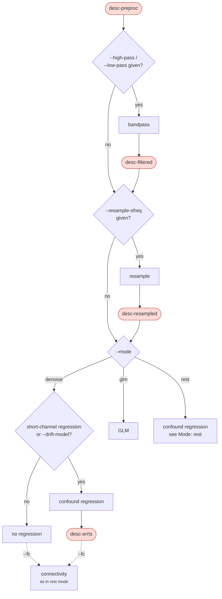
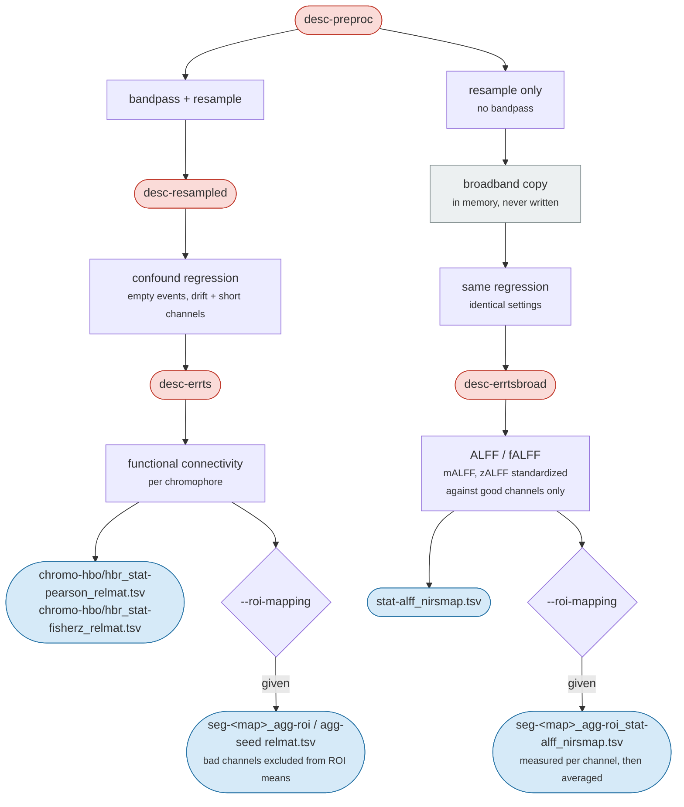

# Processing workflow

`nirspipe ... participant` runs each subject through preprocessing and then, when `--mode` is given, through postprocessing. The steps always run in the same order. `nirspipe ... group` then builds the cohort pages from every run's quality record. Dyad analysis has its own commands, described in [Hyperscanning](hyperscanning.md). Every flag is listed in [Usage](usage.md), and every file in [Outputs](outputs.md).

In the diagrams, rounded boxes are files written to `sub-<label>/nirs/`, plain boxes are operations, and dashed edges are optional. Each run also draws its own provenance graph, `sub-<label>/figures/<run>_desc-provenance_nirs.png`, showing what that run did.

## Preprocessing

Preprocessing turns raw light intensity into haemoglobin concentration changes in five steps. Each step writes a SNIRF file with a JSON sidecar that records its settings.


Quality metrics are measured once at the end, from the files these steps leave behind; see [QC](qc.md).

### BIDS validation

If bids-validator is installed, the input is checked before anything is read. An error stops the run; warnings do not. `--skip-bids-validation` skips the check.

### Optical density

Raw intensity is converted to optical density with MNE-Python and written as `desc-od`. Some devices write a few dark frames when they start or stop recording. These frames are filled from the nearest good frame and marked as excluded time (`BAD_edge`, see [Excluded time](#excluded-time)), so they do not distort the rest of the run.

### Channel screening

Screening finds channels whose optodes did not touch the scalp well. It looks for the heartbeat in each channel: a channel with good contact shows a clear cardiac pulse. Two measures are computed, the scalp coupling index (SCI) and peak spectral power (PSP).

The heartbeat is looked for in the cardiac band, `--cardiac-l-freq` to `--cardiac-h-freq`. It has no default, because heart rate depends on age. Pick it from the table below, or let `--population` fill it in ([Population](usage.md#population)). A task that raises the heart rate, such as exercise, needs a higher top edge. The reports give the heart rate measured from the recording and say when it falls outside the band you chose.

| Age | Heart rate (beats/min) | Cardiac band (Hz) | Breathing rate (breaths/min) | Respiration band (Hz) |
|---|---|---|---|---|
| birth to 3 months | 90 to 181 | 1.5 to 3.1 | 25 to 66 | 0.4 to 1.1 |
| 3 to 12 months | 93 to 175 | 1.5 to 3.0 | 22 to 64 | 0.3 to 1.1 |
| 1 to 2 years | 82 to 156 | 1.3 to 2.6 | 19 to 53 | 0.3 to 0.9 |
| 2 to 4 years | 70 to 142 | 1.1 to 2.4 | 17 to 38 | 0.2 to 0.7 |
| 4 to 8 years | 59 to 131 | 0.9 to 2.2 | 16 to 29 | 0.2 to 0.5 |
| 8 to 12 years | 52 to 115 | 0.8 to 2.0 | 14 to 25 | 0.2 to 0.5 |
| 12 to 18 years | 43 to 108 | 0.7 to 1.8 | 11 to 23 | 0.1 to 0.4 |
| adults | 47 to 103 | 0.7 to 1.8 | 9 to 28 | 0.1 to 0.5 |

The rates come from Fleming et al. (2011) for children, Ostchega et al. (2011) for adult heart rate and Rückert-Eheberg et al. (2025) for adult breathing rate. `--resp-l-freq` / `--resp-h-freq` set the respiration band the reports use.

The recording is cut into 10 s windows. A window passes when the channel's SCI reaches `--sci-threshold`, and a channel is marked bad when fewer than `--min-good-frac` of its windows pass (0.75 by default). `--psp-threshold` is optional; when given, a window has to pass PSP as well. With `--screen-scope task`, only windows inside the task blocks count, so a noisy pause between blocks is not held against a channel. For example, for adults:

```
nirspipe bids/ derivatives/ participant --population adult --sci-threshold 0.8
```

`--population adult` fills the cardiac and respiration bands from the adult row of the table, and the DPF at age 30. On a 690/850 nm device, typing them yourself does the same: `--cardiac-l-freq 0.7 --cardiac-h-freq 1.8 --resp-l-freq 0.1 --resp-h-freq 0.5 --dpf 6.32 5.23`.

```{figure} figures/screening_scipsp.png
:alt: Windowed SCI, PSP and CV heatmaps, channels by time
:width: 100%

Windowed SCI, PSP and CV of one recording, channels by time, with each channel's mean and the line it is held to beside the heatmap.
```

Bad channels are **marked, not removed or interpolated**, so every subject keeps the same channel list. A channel is bad when:

- screening rejected it;
- you named it with `--bad-channels`, as a list of labels or as a table ([Data preparation](data-preparation.md#tables-that-name-recordings));
- the recording's BIDS `channels.tsv` marks it `bad` (`--ignore channel-status` turns this off).

A table's `keep_channels` column keeps a channel that screening would have rejected. Writes `desc-sci`.

### Motion correction

Motion artifacts are corrected in optical density. `--motion-correction` picks the method; `tddr` is the default.

| `--motion-correction` | Method | Reference |
|---|---|---|
| `tddr` | Temporal derivative distribution repair, as implemented in MNE-Python | Fishburn et al. (2019) |
| `wavelet` | Wavelet filtering | Molavi and Dumont (2012) |
| `tpca` | Targeted principal component analysis | Yücel et al. (2014) |
| `spline` | Spline interpolation | Scholkmann et al. (2010) |
| `spline_sg` | Spline interpolation followed by Savitzky-Golay smoothing | Jahani et al. (2018) |
| `wavelet_tddr` | `wavelet`, then `tddr` on its output | |
| `spline_wavelet` | `spline`, then `wavelet` on its output | Di Lorenzo et al. (2019) |
| `none` | No correction; `desc-motcorrected` is not written | |

The methods differ in how much of the brain response they keep, not only in how much noise they remove: `tddr` makes a small response slightly smaller even when there was no motion. Response sizes are only comparable between recordings corrected the same way, so correct a whole study with one method. `--motion-std-thresh` and `--wavelet-iqr` tune the methods that use them ([Usage](usage.md#nirspipe)).

Writes `desc-motcorrected`. The report shows the signal before and after correction ([QC](qc.md#motion-correction-footprint)).

```{figure} figures/motion_gvtd_carpet.png
:alt: Motion-band GVTD traces above carpets of the optical density before and after correction
:width: 100%

The motion-band GVTD of the long and the short channels above a carpet of the optical density, before and after correction, on one scale; the dashed line is the run's threshold.
```

### Beer-Lambert law

The corrected optical density is converted to HbO and HbR concentration changes with the modified Beer-Lambert law. It needs a differential pathlength factor (DPF), which grows with age. `--dpf` takes:

- one number for every wavelength, or one per wavelength, shortest first;
- `age`, which computes the factor from each participant's age in `participants.tsv`, by the equation of Scholkmann and Wolf (2013). It is meant for the frontal head and ages 0 to 70; outside that range the run warns.

| Age (years) | 690 nm | 735 nm | 760 nm | 780 nm | 805 nm | 830 nm | 850 nm |
|---|---|---|---|---|---|---|---|
| 0 | 5.31 | 5.30 | 5.29 | 5.22 | 5.03 | 4.67 | 4.22 |
| 1 | 5.37 | 5.36 | 5.34 | 5.28 | 5.09 | 4.73 | 4.28 |
| 5 | 5.53 | 5.52 | 5.51 | 5.44 | 5.25 | 4.89 | 4.44 |
| 10 | 5.71 | 5.70 | 5.68 | 5.62 | 5.43 | 5.07 | 4.62 |
| 18 | 5.97 | 5.96 | 5.94 | 5.88 | 5.69 | 5.33 | 4.88 |
| 25 | 6.18 | 6.17 | 6.15 | 6.09 | 5.90 | 5.54 | 5.09 |
| 30 | 6.32 | 6.31 | 6.30 | 6.23 | 6.04 | 5.68 | 5.23 |
| 40 | 6.60 | 6.59 | 6.58 | 6.51 | 6.32 | 5.96 | 5.51 |
| 50 | 6.87 | 6.86 | 6.85 | 6.78 | 6.59 | 6.23 | 5.78 |
| 60 | 7.13 | 7.12 | 7.11 | 7.04 | 6.85 | 6.49 | 6.04 |
| 70 | 7.39 | 7.38 | 7.36 | 7.30 | 7.11 | 6.75 | 6.30 |

How to choose: in a cohort of similar age, one value for everyone is fine; read it off the table at the cohort's mean age, or let `--population` pick it. Across a wide age range, use `age`: from 18 to 70 years the factor rises by about 30%, so one shared value would make older participants' responses look larger than younger ones'. The DPF scales response sizes (betas, block averages, ALFF) but not t values or correlations. Writes `desc-preproc`, the end of preprocessing.

### Auxiliary channels

If the SNIRF file has an `aux` group (accelerometer, gyroscope, pulse), preprocessing copies it into `desc-aux_timeseries.tsv.gz`. The report draws the motion sensors beside its motion figures.

### Optode placement

Preprocessing places the optodes on a head template and writes `space-<template>_channels.tsv`: one row per channel, with its position and its nearest cortical region (Desikan-Killiany, and Brodmann area on fsaverage). It is the region nearest the channel, not a model of where its light travels. The brain figures and the dyad tables use this placement.

The template is fsaverage, an adult head, unless `--template` names one of MNE's infant templates (`2wk` to `2yr`; O'Reilly et al. 2021). With `--dpf age` or `--population infant`, each participant gets the template nearest their age. No template fits ages 2 to 18, so such a participant needs `--template`. An infant template is downloaded the first time it is needed (about 630 MB).

Placement uses the landmarks in the file (nasion, preauricular points) when there are at least three; otherwise it finds the reading of the coordinates that puts the optodes on the scalp. A recording it cannot place, such as one with a flat 2-D layout, gets `n/a` positions and a warning on its report.

## Postprocessing

`--mode` picks the analysis: `denoise`, `glm` or `rest`. All three share the bandpass and resampling, and each mode has its own defaults, which `--config` and the command line override ([Mode defaults](usage.md#mode-defaults)).



### Filling corrupted spans

When a recording has corrupted time marked ([Excluded time](#excluded-time)), it is filled in before the bandpass, so the artifact does not spread through the filter. `--censor-fill` picks how: `linear` (the default), `spline` or `lomb`. The filled time is still left out of every result.

### Bandpass and resampling

`--high-pass` and `--low-pass` set the bandpass; `none` switches off a cutoff the mode would otherwise fill in. The default filter is a zero-phase Butterworth (`--filter-method iir`, `--filter-order 4`); `--filter-method fir` is the alternative. Writes `desc-filtered`. `--resample-sfreq` then resamples, writing `desc-resampled`.

:::{warning}
A low-pass filter, or resampling, makes the autoregressive noise models (`--noise-model`) less accurate. In a task GLM the betas are fine, but the t values come out too large. If you need a low-pass before a GLM, consider `--noise-model ols`. The run warns when this applies.
:::

### Mode: denoise

Cleans the data for analyses done outside the package. It applies the bandpass and resampling and, when short-channel regression or `--drift-model` is on, regresses those out and writes the result as `desc-errts`. With `--fc` it also computes connectivity, as in rest mode.

### Mode: glm

A first-level GLM, built with nilearn through MNE-NIRS. It writes the residual (`desc-errts`), the design matrix (`design.tsv`), the fit per channel (`desc-glm_nirsmap.tsv`) and each condition's block average (`desc-blockavg_timeseries.tsv`).

**Events.** The design comes from the SNIRF annotations, each given the duration `--stim-dur`, or from a BIDS `_events.tsv` named by `--events-path`. Use one or the other. Every event needs a duration above 0; give each event its real length (a button press can be 0.1 s).

**Design.** `--hrf-model` sets the response shape (`spm` by default). `--drift-model` sets the slow-drift model (`cosine` by default), with its cutoff set by `--drift-high-pass` ([Choosing the drift cutoff](#choosing-the-drift-cutoff)).

```{figure} figures/glm_design.png
:alt: A GLM design matrix drawn as an image
:width: 100%

A design matrix as the report draws it: the condition regressors, the short-channel regressors, the cosine drift basis and the constant, one row per sample.
```

**Noise model.** fNIRS noise is correlated over time, which a plain least-squares fit ignores. `--noise-model auto` (the default) fits an autoregressive model to each channel. `ols` fits none. `ar_irls` also down-weights outlying samples such as leftover motion, and `worsley` is another AR estimate; see [Usage](usage.md#nirspipe).

**Short-channel regression.** Short channels (at or under `--short-max-dist`) see only the scalp, so regressing them out removes scalp blood flow from the long channels. It is on by default whenever the montage has short channels (`--short-channel auto`, which uses `pca`); `mean` uses their average instead, and `none` switches it off. This is not the same as MNE-NIRS's `short_channel_regression`, which subtracts each long channel's nearest short channel.

**Contrasts.** `--contrast-file` names a table of contrasts between conditions ([Contrast file](usage.md#contrast-file)), written to `desc-contrast_nirsmap.tsv`.

**P values.** The tables give uncorrected, two-sided p values, each on its channel's own residual degrees of freedom, which the `df` column states (fewer than the samples under the robust and censored fits). `--p-correction` (`fdr_bh`, `fdr_by`, `holm` or `bonferroni`) adds corrected ones, over the good long channels.

**Block average.** Each condition's trials averaged per channel, from `--epoch-tmin` to `--epoch-tmax` (-5 to 25 s by default). Trials that touch excluded time are left out.

Bad channels are fitted too and flagged with `bad = True`, so every subject's table has the same rows.

#### Choosing the drift cutoff

The cosine drift model removes slow changes below `--drift-high-pass`. Set the cutoff too high and it removes part of your task too, because a condition that repeats every `T` seconds is itself a slow rhythm at `1/T` Hz. A common choice, the one nilearn and MNE-NIRS suggest, is `1/(2T)`, with `T` the longest gap between two trials of the same condition: blocks every 60 s give 1/120, about 0.008 Hz. If you also use `--high-pass`, do not set the cutoff below it. The run warns you when the value is outside these limits.

`--drift-high-pass auto` applies this rule to each run from its own events, never above 0.01 Hz (nilearn's default), and the report says which condition set the value. It works with `--mode glm` only. Type a number instead when every run should use the same value, or when the recording has markers that are not conditions, such as a start and an end marker; `nirspipe-prep edit-markers` can also remove them.

### Mode: rest

Resting-state analysis: drift and short channels are regressed out, then connectivity and ALFF are computed. The mode uses a 0.01 to 0.08 Hz bandpass and a 0.01 Hz cosine drift by default.



The regression runs twice: once on the bandpassed data for connectivity (`desc-errts`), and once on data without the bandpass for ALFF (`desc-errtsbroad`), because fALFF compares the band with the whole spectrum.

**Connectivity.** The Pearson correlation between every pair of long channels, per chromophore, with its Fisher z. Short channels are left out, as in the dyad tables. A bad channel is a blank row and column. The diagonal is 1 in the correlation matrix and blank in the Fisher z one, where it would be infinite.

**Amplitude.** Per channel:

| Column | Definition |
|--------|------------|
| `alff` | Mean amplitude across the `[high_pass, low_pass]` band |
| `falff` | Band amplitude over total amplitude, DC excluded, in `[0, 1]` |
| `malff` | `alff` divided by the mean `alff` of its own chromophore |
| `zalff` | `alff` z-scored within its own chromophore |

```{figure} figures/rest_connectivity.png
:alt: HbO and HbR channel correlation matrices above ALFF and fALFF per channel
:width: 100%

The rest-mode panel of the report: HbO and HbR channel correlation matrices on one scale, and ALFF and fALFF per channel for each chromophore.
```

**Regions.** With `--roi-mapping`, each region's good channels are averaged into one signal, and region-to-region and region-to-channel (seed) connectivity are computed from those signals. ALFF is averaged within each region after it is measured.

### Connectivity on task data

`--fc` computes the same connectivity in `glm` mode (from the residual after the task is modelled out) and in `denoise` mode. Give `--high-pass` / `--low-pass` too; without a bandpass the correlations mostly reflect slow drift.

### Combining runs

`--combine-runs` joins the runs of one task after each has been processed, so connectivity uses all of them. Each run is z-scored first, so a noisier run does not dominate. ALFF and the GLM stay per run. A task with a single run is not joined.

### Chromophores

`--chromophores` picks what the analysis tables carry: `hbo`, `hbr` and `hbt` (total haemoglobin, HbO plus HbR). The default is `hbo hbr`. The dyad commands use `--wtc-chroma` for the same choice ([Hyperscanning](hyperscanning.md)).

## Excluded time

A run is always processed whole; nothing is cut. Time that should not count is marked with an annotation starting with `BAD_`, and every result leaves those frames out. There are two kinds:

| Kind | Annotation | Comes from |
|------|------------|------------|
| unselected | `BAD_unselected` | `--keep-spans`: everything outside the stretches you list |
| corrupted | any other `BAD_` | `--bad-spans` (`BAD_manual`), `--gvtd-censor` (`BAD_gvtd`), dark frames at the edges (`BAD_edge`), or `BAD_` spans already in the file |

Corrupted time is filled before filtering ([Filling corrupted spans](#filling-corrupted-spans)); unselected time is real data and is kept as it is. `--keep-spans` and `--bad-spans` take tables of `onset` and `duration` in seconds ([Data preparation](data-preparation.md#choosing-stretches-of-a-recording)). `--gvtd-censor` marks motion automatically; it is off by default.

The output files keep the full length of the run, and the values at excluded frames are not NaN. Tools that ignore annotations should read the sidecar's `excluded_spans`, or use `--export-mean-filled`, which writes a copy with every excluded frame set to its channel's mean (fine for correlations, not for spectra or a GLM).

Excluded time applies to all channels at once. For a problem on a single channel, mark the channel bad instead.

## Group level

`nirspipe BIDS_DIR OUTPUT_DIR group` reads the quality records under `OUTPUT_DIR` and writes the cohort page, `desc-subjects_report.html` with its table `desc-subjects_qc.tsv` and the same per condition, `desc-conditions_qc.tsv`, and, when the tree has dyad records, the dyad cohort page `desc-groups_report.html`. See [QC](qc.md#cohort-reports).
