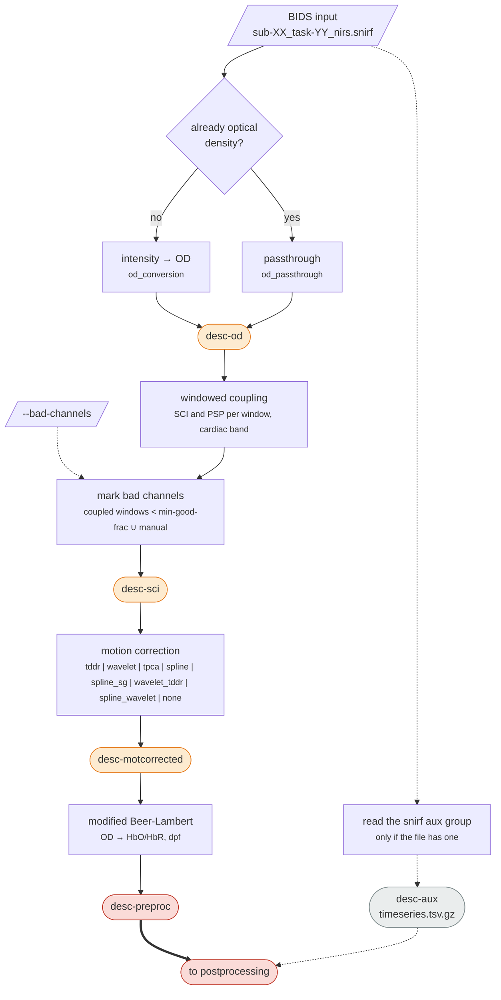
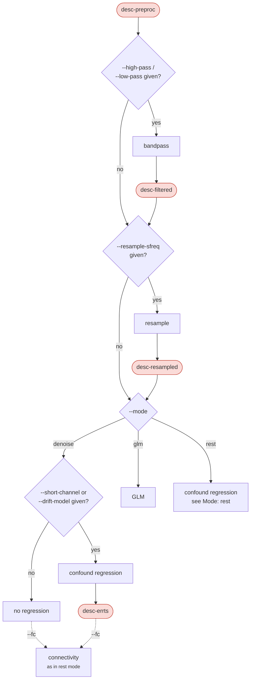

# Processing workflow

`nirspipe ... participant` runs each subject through preprocessing, which always runs in a fixed order, and then through postprocessing when `--mode` is given. `nirspipe ... group` gathers the per-run quality records into the cohort pages. Dyad analysis is a separate set of commands, described in [Hyperscanning](hyperscanning.md). Every flag named below is listed in [Usage](usage.md), and every file in [Outputs](outputs.md).

In the diagrams, rounded boxes are files written to `sub-<label>/nirs/`, plain boxes are operations that leave no file of their own, and dashed edges are optional. They show every branch the code can take. What one particular run did is drawn by the provenance graph it writes, `sub-<label>/figures/<run>_desc-provenance_nirs.png`, which [`nirspipe-qc provenance`](usage.md#nirspipe-qc) can regenerate for any past run.

## Preprocessing

Preprocessing turns raw intensity into haemoglobin concentration in five steps that always run in this order. Each step writes a SNIRF with a JSON sidecar recording its settings and its source files. The only branch is the input check: a recording that is already optical density skips the conversion.



No quality metric is measured inside this diagram. The run's metrics are measured once, after preprocessing and postprocessing have both finished, from the files they left behind; see [QC](qc.md).

### BIDS validation

Before any data is read, the input is checked with bids-validator when one is installed. An error stops the run, naming the error codes and the first files each one names; warnings do not. Without a validator the run goes on with a warning, and `--skip-bids-validation` skips the check. Either way, files BIDS does not recognise are left out when the dataset is indexed.

### Optical density

Raw intensity is converted to optical density, $\Delta OD_\lambda = -\log(I / I_0)$, with MNE-Python. Writes `desc-od`.

### Channel screening

The scalp coupling index (SCI) measures the strength of the cardiac pulsation in the optical density, as a proxy for how well the optode touches the scalp. Peak spectral power (PSP) measures the same pulsation in the frequency domain; movement that keeps the two wavelengths correlated inflates SCI but not PSP. Both are measured in the cardiac band set by `--cardiac-l-freq` / `--cardiac-h-freq`, which has no default because it depends on the population.

Neither metric decides on its own. They are paired inside short windows (`--window-length`, 10 s by default): a window counts as *coupled* when the channel clears both `--sci-threshold` and `--psp-threshold` (0.1 by default) in it, and a channel is marked bad when it is coupled in fewer than `--min-good-frac` (0.75 by default) of the windows that count. `--screen-scope` says which windows count: `run`, the whole recording, or `task`, only the annotated blocks, so the lead-in and the gaps between blocks are not held against a channel. `task` falls back to `run` when no annotation is long enough to hold two windows. A channel coupled for only part of a recording can therefore be rejected even when its whole-run SCI and PSP pass. The same criteria are used by every path that screens: the pipeline, the raw QC report, the per-trial scoring and the dyad commands.

```{figure} figures/screening_scipsp.png
:alt: Windowed SCI, PSP and CV heatmaps, channels by time
:width: 100%

Windowed SCI, PSP and CV of one recording, channels by time, with each channel's mean and the line it is held to beside the heatmap.
```

Bad channels are **marked, not removed or interpolated**. Three sources are unioned into one set:

- the channels screening rejected;
- the channels named by `--bad-channels`, either as source-detector labels or as a table with optional `participant_id`, `session`, `task` and `run` columns ([Data preparation](data-preparation.md#tables-that-name-recordings));
- the channels the recording's BIDS `channels.tsv` marks `bad` in its `status` column. The nearest `channels.tsv` is read, as BIDS inheritance allows, `status` is compared without regard to case, and a channel marked `good` is still screened like any other. `--ignore channel-status` turns this off. The `desc-sci` sidecar records them as `parameters.channels_tsv_bads`, and the report shows them as `BAD (manual)`.

Naming either wavelength of a pair rejects the pair. A pair in the table's `keep_channels` column leaves screening's rejections, not the other two sources; the `desc-sci` sidecar records it as `parameters.kept_channels` and the Methods name it. When the listed channels leave no usable channel, the run stops. A window touching any `BAD_` span is not counted ([Excluded time](#excluded-time)), so the run has one channel set, chosen on the time it keeps. Writes `desc-sci`.

### Motion correction

Motion artifacts are corrected in optical density, before the conversion to haemoglobin. `--motion-correction` picks the method; `tddr` is the default.

| `--motion-correction` | Method | Reference |
|---|---|---|
| `tddr` | Temporal derivative distribution repair, as implemented in MNE-Python | Fishburn et al. (2019) |
| `wavelet` | Wavelet filtering | Molavi and Dumont (2012) |
| `tpca` | Targeted principal component analysis | Yücel et al. (2014) |
| `spline` | Spline interpolation | Scholkmann et al. (2010) |
| `spline_sg` | Spline interpolation followed by Savitzky-Golay smoothing | Jahani et al. (2018) |
| `wavelet_tddr` | `wavelet`, then `tddr` on its output | |
| `spline_wavelet` | `spline`, then `wavelet` on its output | Di Lorenzo et al. (2019) |
| `none` | No correction; `desc-motcorrected` is not written | |

`--motion-std-thresh` and `--wavelet-iqr` set the spline detection threshold and the wavelet fence of the methods that use them; their per-method defaults are in [Usage](usage.md#nirspipe). The detection threshold is measured against each channel's sample-to-sample change, so the same value marks more of a faster recording; when `spline` or `spline_wavelet` marks over 10% of the samples, the log warns and the report adds a note.

Writes `desc-motcorrected`. The before-and-after comparison the report draws is described in [QC](qc.md#motion-correction-footprint).

```{figure} figures/motion_gvtd_carpet.png
:alt: Motion-band GVTD traces above carpets of the optical density before and after correction
:width: 100%

The motion-band GVTD of the long and the short channels above a carpet of the optical density, before and after correction, on one scale; the dashed line is the run's threshold.
```

### Beer-Lambert law

The corrected optical density is converted to HbO and HbR concentration changes with the modified Beer-Lambert law, $\Delta c = \Delta OD / (\varepsilon \cdot DPF \cdot d)$, where $\varepsilon$ is the molar extinction coefficient and $d$ the source-detector separation. `--dpf` takes one differential pathlength factor for every wavelength or one per wavelength. Writes `desc-preproc`, the end of preprocessing.

### Auxiliary channels

A SNIRF file may carry non-optical channels in its `aux` group, such as accelerometers, gyroscopes or a pulse trace. MNE does not read them, so preprocessing copies them from the input into `desc-aux_timeseries.tsv.gz`, at the rate they were recorded, with the recorded timestamps in a `time` column. No derivative SNIRF holds them, so this table is the only copy carried forward. The report draws the gyroscope and accelerometer rows on its motion figures from it, and `nirspipe-prep crop` carries the aux group into each segment it cuts.

## Postprocessing

`--mode` picks the branch: `denoise`, `glm` or `rest`. The bandpass and the resampling are shared by all three, and each mode fills in its own defaults for the settings below, which `--config` and the command line override ([Mode defaults](usage.md#mode-defaults)). Postprocessing measures no quality metric of its own; the run's quality record gets one section per stage it wrote (`filtered`, `resampled`, `errts`).



### Filling corrupted spans

When the recording carries a corrupted `BAD_` span ([Excluded time](#excluded-time)), every channel is filled across it before the bandpass, so the artifact does not spread through the filter into kept time. `--censor-fill` picks the fill: `linear` (the default) joins the kept samples either side, `spline` runs one cubic spline through every kept sample, and `lomb` rebuilds each span from a Lomb-Scargle fit to the kept samples. A span at the edge of a recording takes the nearest kept value under `linear` and `spline`. The spans stay marked and are left out of every later estimate, and `desc-preproc` keeps the measured data.

### Bandpass and resampling

The bandpass uses `--high-pass` and `--low-pass`; `none` switches off a cutoff the mode would fill in. `--filter-method iir` (the default) is a zero-phase Butterworth of order `--filter-order` (4 by default) applied forward and backward, so its rolloff is twice the order and its cutoff sits at -6 dB. `--filter-method fir` is a Hamming-windowed linear-phase filter, refused when its length exceeds the recording. Writes `desc-filtered`. `--resample-sfreq` then resamples, writing `desc-resampled`.

:::{warning}
A low-pass, and a resampling, which anti-aliases at the new Nyquist frequency, both undermine prewhitening: on a low-passed series an autoregressive `--noise-model` describes the filter rather than the noise, and the residual stays autocorrelated. In a task GLM the betas hold but the standard errors come out too small. In `rest` or `denoise` the residual `desc-errts` itself changes. Every mode warns about it.
:::

Every filtered stage also opens and closes with the filter settling rather than with anything measured, the more so the lower the cutoff; the report notes how far that reaches into each end.

### Mode: denoise

Applies the bandpass and resampling and stops there, for analyses done outside the package. Given `--short-channel` or `--drift-model`, it also regresses those confounds out of the bandpassed signal, with no task model, and writes the residual as `desc-errts`. `--drift-model` is optional here, since the bandpass already detrends. With `--fc` it writes the connectivity products of rest mode, from the residual or, when no regression ran, from the bandpassed data.

### Mode: glm

A first-level GLM, built with nilearn through MNE-NIRS. It writes the residual as `desc-errts`, the design matrix as `design.tsv` and the fit as `desc-glm_nirsmap.tsv`.

**Events.** The design is built from the SNIRF annotations with every event given the duration `--stim-dur`, or from a BIDS `_events.tsv` named by `--events-path` with its own onsets and durations. One of the two is required, and they are mutually exclusive.

**Design.** `--hrf-model` sets the HRF basis (`spm` by default; `glover`, the derivative and dispersion variants, or `fir` with `--fir-delays`). `--drift-model` sets the drift basis (`cosine` by default, or `polynomial` of order `--drift-order`, or `none`).

```{figure} figures/glm_design.png
:alt: A GLM design matrix drawn as an image
:width: 100%

A design matrix as the report draws it: the condition regressors, the short-channel regressors, the cosine drift basis and the constant, one row per sample.
```

**Cosine drift cutoff.** `--drift-high-pass` has no default in this mode, because it is bounded by the design. The cosine basis spans every frequency below its cutoff, so the cutoff has to sit at or above the data's `--high-pass`, so the task regressors are detrended the way the data was, and below the rate at which a condition repeats, or the basis fits that condition away as drift. A condition whose trials are at most `T` seconds apart repeats at `1/T` Hz, and `1/(2T)` is a cutoff that clears it. The run warns when either bound is crossed, naming each condition the basis would absorb, and suggests a cutoff that clears the slowest.

**Noise model.** `--noise-model` sets the residual autocorrelation model: `ols`, `arN` for an AR model of order N, `auto` (the default) for an AR order of four times the sampling rate, or `ar_irls`. `ar_irls` alternates the AR whitening with a robust refit that down-weights outlying samples such as residual motion, until the betas stop moving; the order is chosen per channel by BIC, capped at the same bound `auto` uses or at N with `ar_irlsN`. Every channel keeps its own AR coefficients. Every mode fits the noise model, `denoise` and `rest` on their confound regression.

**Short-channel regression.** Short channels (at or under `--short-max-dist`) see the scalp only. `--short-channel mean` adds the mean of the good short channels as one regressor per chromophore; `pca` adds one orthogonalised column per good short channel, HbO and HbR decomposed together, which fits the same as entering every short channel. A short channel the regressors span is fitted against itself, so its residual is zero and its connectivity and amplitude values are left blank. A montage with no short channel stops the run; a subject whose short channels were all rejected runs without the regressor, and its record and Methods text say so.

**Auxiliary regressors (experimental).** `--aux-regressors` adds the recording's aux channels to the confound regression, each resampled onto the data's time axis with an anti-alias filter, band-limited to `--high-pass` / `--low-pass` and z-scored. `--aux-channels` picks them by name. Both are withheld from `--help` while they are evaluated.

**Contrasts.** `--contrast-file` names a TOML file of linear contrasts over the condition regressors ([Contrast file](usage.md#contrast-file)), written to `desc-contrast_nirsmap.tsv`.

Every channel is fitted, rejected ones included; their rows carry `bad = True` rather than being dropped, so the table shape stays the same across subjects.

### Mode: rest

Resting-state analysis: a confound regression with no task regressors, then ALFF and functional connectivity on the residuals. The mode fills a 0.01 to 0.08 Hz bandpass and a 0.01 Hz cosine drift. The confound regression runs **twice, on different inputs**:


fALFF is the band's share of the total spectral amplitude, so ALFF and fALFF are read from a residual that was detrended but never low-passed (`desc-errtsbroad`), while connectivity is read from the bandpassed one (`desc-errts`).

**Connectivity.** Pearson correlation between every pair of channels, per chromophore, with its Fisher z. A rejected channel is a blank row and column, so every subject's matrix keeps one shape and one channel order.

**Amplitude.** Per channel, from the amplitude spectrum of the broadband residual:

| Column | Definition |
|--------|------------|
| `alff` | Mean amplitude across the `[high_pass, low_pass]` band |
| `falff` | Band amplitude over total amplitude, DC excluded, in `[0, 1]` |
| `malff` | `alff` divided by the mean `alff` of its own chromophore |
| `zalff` | `alff` z-scored within its own chromophore |

ALFF needs both cutoffs; with either switched off it is skipped, and connectivity is still computed.

```{figure} figures/rest_connectivity.png
:alt: HbO and HbR channel correlation matrices above ALFF and fALFF per channel
:width: 100%

The rest-mode panel of the report: HbO and HbR channel correlation matrices on one scale, and ALFF and fALFF per channel for each chromophore.
```

**Regions.** With `--roi-mapping`, each region's good channels are averaged into one signal, and the region-by-region correlation and each region's seed map (region against every channel) are computed from those signals. The amplitude measures are averaged within each region after they are measured, the opposite order, with `n_channels` beside them. A region left with no good channel stays in every output as a blank entry, so every subject's tables have the same rows. Each ROI product's sidecar records, as `roi_channels`, which channels the region was actually averaged from.

### Connectivity on task data

`--fc` writes the connectivity products of rest mode in the other two modes: in `glm` from the residual the task was modelled out of, in `denoise` from its confound residual or its bandpassed data. ALFF is not written, since it needs a broadband residual. Give `--high-pass` / `--low-pass` too; without a bandpass the correlations are dominated by drift.

## Excluded time

A run is always processed whole. Time that should not count is marked with an annotation whose description starts with `BAD_`, and every estimate leaves those frames out. Nothing is cut: every output keeps the run's full length, the spans travel with it as annotations, and every sidecar lists them under `excluded_spans`. With no span at all, every step takes its plain route.

| Kind | Annotation | Comes from | The data there |
|------|------------|------------|----------------|
| unselected | `BAD_unselected` | `--keep-spans`: everything outside the stretches its table lists | Intact measurements you chose not to count |
| corrupted | every other `BAD_` description | `BAD_manual` from `--bad-spans`, `BAD_gvtd` from `--gvtd-censor`, or any `BAD_` span the input file carries | Damaged by motion or another artifact |

The two kinds part ways only before the filters: corrupted time is filled first ([Filling corrupted spans](#filling-corrupted-spans)), intact time is not. From the first estimate on, both are left out alike. An unknown `BAD_` description counts as corrupted.

`--keep-spans` and `--bad-spans` take tables of `onset` and `duration` in seconds on each recording's own time axis, with optional columns limiting a row to some recordings ([Data preparation](data-preparation.md#choosing-stretches-of-a-recording)). `--gvtd-censor` marks the frames where the global variance of the temporal derivative (GVTD) exceeds `--gvtd-censor-n-std` standard deviations of its left tail above its mode, on the channels screening kept, and censors any surviving stretch shorter than `--gvtd-min-epoch-s` with it. It is off by default.

| Step | What it does with `BAD_` time |
|------|-------------------------------|
| Channel screening | A window touching a span is not counted. `BAD_gvtd` is made after screening, so it never changes the channel set. A run left with fewer than two windows stops. |
| Motion correction | Runs over the whole recording. |
| Fill, bandpass, resampling | Corrupted spans are filled, then everything is filtered whole. |
| GLM and confound regression | The design is built on the full time axis, and the `BAD_` rows are dropped from data and design at fit time. AR coefficients come only from samples whose lags lie in kept time. The fit is applied to the whole run, so `desc-errts` stays full length. A fit with fewer than three kept frames per regressor is refused, and a condition with no kept rows is dropped and named. |
| Connectivity | Pearson r over the kept frames. |
| ALFF, fALFF | A Lomb-Scargle periodogram of the kept samples. |
| `--min-time` | A run with fewer kept seconds than this gets no connectivity or ALFF file. Off by default. |
| Dyad coherence and correlation | Each pairing leaves out the union of both members' spans ([Hyperscanning](hyperscanning.md#excluded-time)). |
| QC report | Left out of the condition shares, the trials and the spectra, and listed in an Excluded section. |

Values at `BAD_` frames are never NaN: unselected frames hold the processed measurement, corrupted frames the filtered fill. Read the annotations, or the sidecar's `excluded_spans`, to leave them out. For a tool that ignores annotations, `--export-mean-filled` also writes `desc-meanfilled` beside the final residual, every `BAD_` frame set to its channel's mean over the kept frames. A correlation over it equals one over the kept frames; an amplitude spectrum, a GLM or a coherence over it does not.

A fill keeps an artifact out of the filter but does not restore the signal, and spans are recording-wide: a channel cannot keep a stretch another channel loses. Per-channel problems are what bad channels are for.

## Group level

`nirspipe BIDS_DIR OUTPUT_DIR group` reads the quality records under `OUTPUT_DIR`, not the BIDS input, and needs no preprocessing flag. It writes the cohort page over every run, `desc-subjects_report.html` with its table `desc-subjects_qc.tsv`, and, where the tree also holds dyad records, the dyad cohort page `desc-groups_report.html` with `desc-groups_qc.tsv`. Both are described in [QC](qc.md#cohort-reports).
